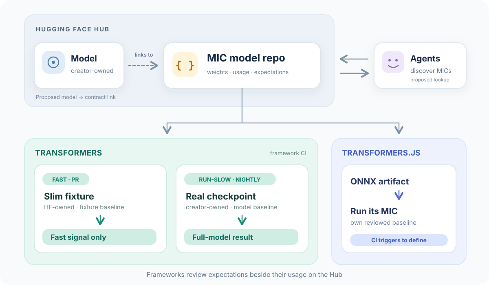

# transformers-mic


A **Model Integration Contract (MIC)** is a proposed standard: next to a Hub
model, an executable check that it works in a framework, run by that
framework's CI. Each MIC has three parts:

- a **fixture**: a shrunk model built from the real checkpoint's config, with its
  tokenizer and processor files copied unchanged
- a **usage path**: runnable Markdown that does what users do, such as generating
  text or running a training step
- **baselines**: the outputs that usage produced, reviewed by a human

Words used throughout the docs:

- **checkpoint**: the real Hub model a MIC covers (`mistralai/Mistral-Large-4-1T-A52B`).
- **fixture**: the small model a MIC runs on CPU, built from one checkpoint by the
  [recipe](docs/fixtures.md#recipe) and published as `huggingface-mic/<name>-mic`.
  Older text, repository and file names say *slim fixture* or *slim model*: same thing.
- **shrink**: the recipe step that turns the checkpoint's config into the fixture's
  (the *shrunk config*); [`tmic shrink`](docs/cli.md#how-was-the-fixture-shrunk)
  shows what it kept.
- **tiny** is not a MIC term: Transformers' own `tiny-random-*` test models are never
  fixtures or sources, and a checkpoint named *tiny* (`openai/whisper-tiny`) is a
  real checkpoint like any other.

Fixtures run on framework PRs (CPU, seconds); real checkpoints run after merge,
nightly and before release. **A fixture pass is a fast regression signal, not a pass
for the real model.**

This repository holds the `tmic` CLI, the fixture builder and the runner. MICs are
published in [`huggingface-mic`](https://huggingface.co/huggingface-mic) and pinned
by the [fleet dataset](https://huggingface.co/datasets/huggingface-mic/transformers-fleet);
coverage is in the [coverage space](https://huggingface.co/spaces/huggingface-mic/mic-coverage).
In Transformers, the contracts job runs on PRs and reports failures without
blocking ([status](docs/evidence.md#transformers-ci-proof)).



## Try it locally

```sh
pip install "transformers-mic[runtime]" "hf-doc-builder @ git+https://github.com/huggingface/doc-builder.git"
hf auth login
tmic fixture org/model --open
```

This shrinks `org/model` to a tiny config and weights in `./model-fixture/fixture/`
and compares both with the real checkpoint: config values that changed, tensor names
matched against the source, and a layer-by-layer page. It runs no contract code and
calls no LLM. Edit `fixture/config.json` and rerun to shrink with your values.

Then build the whole contract around it:

```sh
tmic run org/model --local-only --fixtures-only --no-history --bill-to ''
```

This drafts a contract for `org/model`, builds its fixture and records baselines
on your machine, asks you to review each step, and uploads nothing. See
[Try it locally](docs/cli.md#try-it-locally) for the flags. `tmic run --mode agent`
gives agents a JSON protocol for the same questions.

Cloud baselines and publication are for maintainers: [CLI guide](docs/cli.md),
[cloud baselines](docs/cloud-baselines.md) (dashboard activation is still pending).

## Documents

Start with:

- [CLI guide](docs/cli.md): `tmic`, from a checkpoint to a published MIC.
- [The standard](docs/standard.md): why MICs, the repository layout, manifest, checks and pins.
- [Fixtures](docs/fixtures.md): the shrink recipe and the weight experiments.
- [Evidence](docs/evidence.md): replays, backfills, stability and cost.
- [Pilot](docs/pilot.md): the proposed adoption pilot and the results so far.

Details: [full example](example/README.md), [technical design](docs/design.md),
[Hub layout](docs/hub-organization.md), [fixtures in Transformers CI](docs/slim-models-in-transformers-ci.md),
[Transformers CI proof](docs/transformers-ci-proof.md), [improving contracts](docs/improving-contracts.md),
[smoke vs assertions](docs/smoke-vs-assertions.md), [problems and open questions](docs/problems-and-opened-questions.md),
[cloud baselines](docs/cloud-baselines.md), [end-to-end tests](docs/end-to-end-tests.md),
[agent walkthroughs](docs/agent-walkthrough/README.md), [maintainer slides](docs/slides/index.html),
[changelog](CHANGELOG.md), [releasing](docs/release.md).
