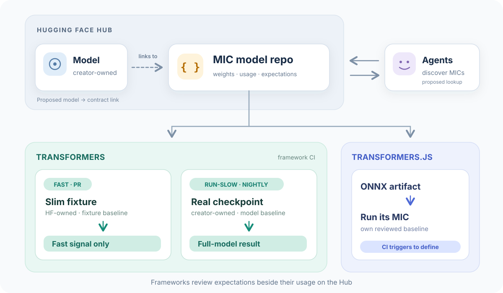

# transformers-mic


New MIC artifacts use the [`huggingface-mic`](https://huggingface.co/huggingface-mic) Hub organization.
See [Hub layout](docs/hub-organization.md).

Python package and CLI for model integration contracts, slim fixtures, and measured
expectations. See the [CLI guide](docs/cli.md) for installation, HF Inference
Providers (default `Qwen/Qwen3.8-27B`), and the create/update/publish workflow.

## Model Integration Contract

**A proposed standard**: next to any Hub model, an executable check that it works in a given framework, run by that framework's CI.

## Summary

For each usage path (an architecture and a task, across the checkpoints that share it), publish a small integration contract on the Hub and run it from framework CI.

A contract is ordinary user code: load the model, call the public API, report the result. The proposal runs small fixtures on framework PRs (CPU, seconds) and real checkpoints after merge, nightly, and before release. The prototype runs here, with a branch-only proof in Transformers CI. Transformers.js can use the same contracts.

**A slim pass is a fast regression signal, not a pass for the real model.** Run on full checkpoints, contracts can replace model-specific integration tests in `run-slow`; other slow tests stay ([CI integration](docs/slim-models-in-transformers-ci.md)).



**[Full example](example/README.md):** a runnable MIC for SmolLM text generation in Transformers and Transformers.js, plus seven more usage paths (CLIP, BERT, T5/UMT5, Whisper, Wav2Vec2, MusicGen Melody, checkpoint-only Whisper speech) on the same runner.

The first goal is CI, not a Hub feature. The same contracts could later back compatibility status, tested snippets, Colabs, or agent usage.

## Problem

- **Compatibility is expensive to verify.** Integration tests need real checkpoints, large downloads, and GPUs, so each PR runs only a small part of the fleet. Regressions surface late: nightly, at release, or from users.
- **Copies drift.** Test code, documented usage, and Hub snippets diverge.
- **Agents guess.** In two [recorded runs](docs/agent-walkthrough/README.md) on Florence-2, both agents reconstructed a working path and neither could check output against a reviewed baseline. This shows friction, not a measured MIC gain ([assessment](docs/evidence.md#how-agents-use-the-hub-today)).

## The proposed standard

A MIC covers one usage path and every checkpoint on it. Each part links to the [full example](example/README.md).

1. **One MIC repository per slim model.** Creators' checkpoint repos stay unchanged. Hugging Face owns a model repo such as [`huggingface-mic/qwen2_5_omni-mic`](https://huggingface.co/huggingface-mic/qwen2_5_omni-mic), containing its slim weights, contract, usage and reviewed expectations. Frameworks own the review of their expectations; `tests/contracts.lock` pins a snapshot of the shared [fleet dataset](https://huggingface.co/datasets/huggingface-mic/transformers-fleet).
2. **Fixed layout:**

   ```text
   huggingface-mic/qwen2_5_omni-mic/
     config.json
     model.safetensors
     build.json
     integration.json
     .mic-repo.json                            # separates contract files from weights
     integrations/transformers/
       usage.md
       expectations/cpu-x86_64-bf16/
         mic-qwen2_5_omni-slim.bfloat16.json
     integrations/transformers.js/             # when this framework is supported
       integration.js
       expectations/<platform>/<target>.<variant>.json
   transformers/tests/contracts.lock           # shared fleet dataset commit SHA
   ```

   The fixture pin's `target` identifies its expectation file. See [Hub layout](docs/hub-organization.md).

3. **A static manifest.** [`integration.json`](example/hub/SmolLM-integration/integration.json) declares checkpoints, each one's fixture, and per framework: entry point, variants, unsupported targets, resources, and a comparison rule per output.
4. **User code as the contract**: the public API with default settings, printing one JSON line. As [doc-builder runnable markdown](example/hub/SmolLM-integration/integrations/transformers/usage.md), it is both documentation and test.
5. **Checks beyond "it ran"**: generated outputs, logits within tolerance, and where training applies, finite loss and gradients and a parameter update.
6. **Reviewed baselines** under `integrations/<framework>/expectations/<platform>/`, per target and variant. A behavior-changing PR measures candidates, has them reviewed, then publishes a new snapshot and updates its lock. Nothing updates approved values automatically.
7. **Shared [fixtures](example/hub/mic-SmolLM-slim).** Processor files copied byte for byte; weights and config shrink. Checkpoints share a fixture only with identical processors, retained config fields, and default dtype.
8. **Everything pinned** in the shared [fleet dataset](https://huggingface.co/datasets/huggingface-mic/transformers-fleet): contract, fixture, checkpoint, and dependency revisions. Transformers keeps only the dataset commit SHA in `tests/contracts.lock`.

[`run.py`](example/run.py) implements the runner prototype and validates its schemas. Remaining pilot work: [technical design](docs/design.md#pilot).

## Why on the Hub, owned by Hugging Face

Hugging Face maintains contracts and fixtures without requiring creator changes. Framework maintainers review expected results in behavior-changing PRs. They live with their framework usage in the same versioned Hub model repository, and each framework pins the reviewed snapshot.

## Pilot run

Proposed adoption pilot: 3–5 usage paths alongside existing tests, measuring regressions, fleet cost, and maintenance. The prototype already exercises eight contracts.

Early results on 1,468 Transformers `main` commits over five months ([shadow backfill](docs/evidence.md#shadow-backfill)):

- Frozen contracts caught the UMT5 regression ([#49135](https://github.com/huggingface/transformers/pull/49135)) at its introducing commit, flagged one benign change, and missed four regressions whose calls they didn't make.
- With those calls added ([how](docs/improving-contracts.md)), all five are caught, no new false alarm, ~13 s per commit on CPU. The new Whisper call found a live bug ([#49403](https://github.com/huggingface/transformers/issues/49403)).
- Scheduled runs on `main` caught a Whisper regression the night it merged, after its PR's CI had passed ([#49456](https://github.com/huggingface/transformers/issues/49456)).
- A call added for one bug caught another nobody targeted: Whisper's assisted `generate` broken by [#48981](https://github.com/huggingface/transformers/pull/48981) for 41 commits, from its introducing commit ([third round](docs/evidence.md#third-round-second-round-calls-and-bfloat16-smollm)).
- A proof job runs in Transformers' own PR CI runner and image, on a branch of `huggingface/transformers`: 8 fixtures in 17 s, selected from changed files, open bugs as narrowed known failures. A reverted UMT5 fix fails it with the backfill's exact deltas, and the repro command in the job summary gives the same failure on a Mac ([proof](docs/transformers-ci-proof.md)).
- No real regression has needed an overfit fixture yet: random twins also caught MusicGen Melody's dropped conditioning (#48679) and Whisper's left-padding bug (#48028) once controlled first segments reached its trigger. Whisper assisted decoding #48108 still eludes both ([replays](docs/evidence.md#overfit-or-random-weights-on-real-regressions)).

Agent reuse is measured separately ([recipe](docs/agent-walkthrough/README.md#controlled-comparison-with-and-without-a-mic)). Remote-code models are out of initial scope.

## Documents

- [Full example](example/README.md): runnable SmolLM MIC, every part of the standard; the runner on eight contracts.
- [Evidence](docs/evidence.md): experiments, regression replay, shadow backfill, overfit vs random.
- [Smoke vs assertions](docs/smoke-vs-assertions.md): which caught regressions raised, and which only a value check sees.
- [Problems and opened questions](docs/problems-and-opened-questions.md): what the pilot must settle.
- [Slim models in Transformers CI](docs/slim-models-in-transformers-ci.md): PR and `run-slow` flows.
- [Transformers CI proof](docs/transformers-ci-proof.md): the fleet in Transformers PR CI, with a one-page write-up for maintainers.
- [Technical design](docs/design.md): layout, CI, checks, baselines, runner.
- [Improving contracts](docs/improving-contracts.md): finding and closing coverage gaps.
- [End-to-end tests](docs/end-to-end-tests.md): every check in this repo, with commands.
- [Small fixtures](docs/fixtures.md): the fixture recipe and its experiments.
- [Agent walkthroughs](docs/agent-walkthrough/README.md): recorded Claude and Codex runs.
