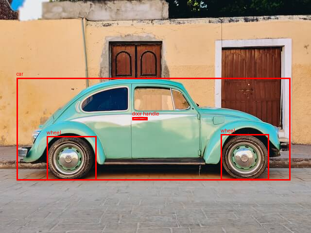

# Local Hugging Face inference — agent walkthrough

> Codex result, recorded on 2026-10-07. See the shared [recipe and prompt](README.md). The output below is preserved apart from this navigation note and the detection image link.

Both tasks completed locally on CPU using the exact requested JPEGs. Task A initially considered BLIP, then selected the already-cached Microsoft Florence-2-base; Task B used the specified Microsoft repository. This is an account of the actual route, including failures, not an idealized recipe.

Started **2026-10-07T06:51:17Z**; report prepared **2026-10-07T07:11:15.317Z**. All timestamps are UTC; Europe/Paris was UTC+02:00.

No pre-existing agent walkthrough or integration-contract document was read. Sources were Hub pages/files, existing package code/metadata, local machine/cache inspection, image data, and prior knowledge. No hosted inference API, delegated agent, or user question was used. Model weights and distributions were already cached; the two input images were downloaded during this run.

## Outcomes and timing

| Milestone | Emitted at (UTC) | Wall time from first machine call | Nested tools / exec wrappers / combined initiated by emission |
|---|---|---|---|
| A: first correct caption on pixel-equivalent PNG | 2026-10-07T06:57:06.282318+00:00 | 5m 49.282s (349.282 s) | 24 / 15 / 39 |
| B: caption plus detection | 2026-10-07T06:57:27.216990+00:00 | 6m 10.216s (370.216 s) | 26 / 16 / 42 |
| A: conservative exact-requested-JPEG completion | 2026-10-07T06:57:45.065349+00:00 | 6m 28.065s (388.065 s) | 28 / 17 / 45 |

Operation 26 subsequently proved the downloaded A JPEG and provisional cached PNG have identical decoded RGB pixels. For strict exact-file comparison, use the later A milestone. Emission timestamps came from the Python process; polling observed them later. Both final outputs were visually validated during batch 18 at approximately 06:57:50 UTC, about 6m 33.5s after start.

B-specific reconnaissance began with the model-card read at 2026-10-07T06:51:51.126Z; its complete output followed 5m 36.090s (336.090 s) later. Setup was shared, so these task windows overlap and must not be summed. Result observation occurred at operation 25 for the first A caption, 28 for B, and 29 for the exact-file A caption; final image inspections were operations 30–31.

The full trace has **36 numbered operations**: **34 nested tools**, plus **two helper-only functions.exec calls** (operations 33–34). There were **21 functions.exec wrappers** altogether, hence **55 actual API-level tool calls** if wrappers and nested calls are both counted. Before report bookkeeping: **32 nested tools + 18 wrappers = 50 calls**. Shared operations appear in both task indexes.

Recording limits: the first shell date has one-second precision. Exact timestamps were not retained for the two report-only helper calls; they are bounded between batch 18's end (2026-10-07T06:57:50.534Z) and this report batch's start (2026-10-07T07:11:15.317Z), rather than invented. Final writing/validation timestamps identify their common batch start. Every nested task command, URL, patch and polling argument is recorded below. Orchestration is accounted for separately. Report-data patch bodies are not recursively duplicated inside themselves. The failed report-assembly call never wrote a script or executed a command.

## Task A — small open model image captioning

Input: <http://images.cocodataset.org/val2017/000000039769.jpg>.

Final repository: [microsoft/Florence-2-base](https://huggingface.co/microsoft/Florence-2-base), revision `5ca5edf5bd017b9919c05d08aebef5e4c7ac3bac`, **231,414,016 parameters**. Its card displays MIT licensing and lists the base model as 0.23B.

Initial candidate: [Salesforce/blip-image-captioning-base](https://huggingface.co/Salesforce/blip-image-captioning-base). Prior familiarity, captioning purpose, the BSD-3-Clause badge and an explicit CPU example supported the choice. No BLIP base weights were cached, and initial API/download access failed. Cached Florence supported captioning and was small enough, so I selected it for A as well. Popularity counts were not a selection signal.

Actual output:

> Two cats laying on a pink couch next to a remote control.

Input dimensions: 640 × 480. SHA-256: `dea9e7ef97386345f7cff32f9055da4982da5471c48d575146c796ab4563b04e`.
Exact-JPEG generation took **1.236s**; model loading plus generation took **3.827s**. Python import startup precedes that timer.

Correctness judgment: direct inspection shows two tabby cats lying on a pink/red couch with remotes. The caption identifies the main subjects, setting and a remote correctly. It omits the second remote, so it is not an exhaustive inventory. **High qualitative confidence for this image**, without a benchmark/generalization claim. The actual JPEG was inspected and was pixel-identical to the fallback PNG.

Final command:
````sh
PYTHONDONTWRITEBYTECODE=1 .venv/bin/python run_florence.py --task A --image task-A-requested.jpg
````

### Numbered Task A tool-call index

All relevant tools, including shared setup and report work, in invocation order. Each linked entry contains the exact command/URL/patch, timestamp, result, decision, signal, and failure text.

1. [Operation 1: Inspect machine](#operation-1) — Empty workspace; system Python 3.9.6 lacked torch/transformers; uv existed. sysctl queries were denied.
2. [Operation 2: Read BLIP and Microsoft model cards](#operation-2) — BLIP had a CPU captioning example and BSD-3-Clause badge. Florence had MIT, a 0.23B size entry, CPU float32 instructions, and task prompts.
3. [Operation 3: Inspect interpreters and query model APIs](#operation-3) — uv was 0.9.26; an unmatched zsh glob prevented the interpreter listing; both Hub API requests failed DNS resolution.
4. [Operation 4: Attempt preapproved curl outside sandbox](#operation-4) — The execution layer rejected escalation before curl ran.
5. [Operation 5: Discover local Python and caches](#operation-5) — Found several Homebrew Pythons, managed Python 3.12.12, and extensive model/package caches. The broad listing was truncated.
6. [Operation 6: Inspect usable model weights and package versions](#operation-6) — Both Microsoft Florence and its community conversion had approximately 463 MB weights. No BLIP base weights were found; some other models had only configuration/tokenizer files.
7. [Operation 7: Read cached configs/source and search input filenames](#operation-7) — Microsoft config recorded transformers_version 4.41.0.dev0, model_type florence2, and custom auto_map. Found the COCO PNG fixture, but no car.jpg.
8. [Operation 8: Inspect community card and live Microsoft config](#operation-8) — Community card advertised native Transformers conversion, but described the base repository as a continued-pretrained large model. Microsoft config confirmed the custom-code layout.
9. [Operation 9: Prepare offline uv cache and environment](#operation-9) — Copied uv index metadata, rewrote payload symlinks to read-only cache locations, scanned image filenames, inspected optional imports, and started uv venv.
10. [Operation 10: Collect uv crash](#operation-10) — uv crashed in Rust system-configuration code.
11. [Operation 11: Create standard venv and enumerate cached dependencies](#operation-11) — Started Python 3.12.12 venv creation and listed compatible cached packages, including tokenizers 0.19.1.
12. [Operation 12: Browse exact requested image URLs](#operation-12) — COCO timed out; the car URL redirected to an inaccessible CDN URL.
13. [Operation 13: Collect standard-venv results](#operation-13) — Standard venv creation succeeded and compatible dependencies were present.
14. [Operation 14: Write setup and inference scripts](#operation-14) — Created setup_cached_env.py and run_florence.py with local CPU float32 inference, offline model loading, hashes, timings, JSON results, and a box overlay.
15. [Operation 15: Check dependencies and attempt inference](#operation-15) — Attached 27 distributions. pip check found missing setuptools and hf-xet; inference was attempted and later failed during imports.
16. [Operation 17: Collect first model-loading failure](#operation-17) — Processor loading succeeded; model loading rejected missing flash_attn.
17. [Operation 18: Search image caches and missing dependencies](#operation-18) — Searched cache filenames for the car, COCO image, and car CDN identifier; located cached setuptools/hf-xet versions.
18. [Operation 19: Inspect import-scanner implementation](#operation-19) — Transformers 4.41.2 scans imports with regex and strips try/except blocks; Florence guards flash_attn with an if statement.
19. [Operation 20: Collect last local cache search](#operation-20) — Found another COCO PNG, no matching car image, and suitable setuptools/hf-xet packages.
20. [Operation 21: View cached COCO fixture](#operation-21) — Image showed two tabby cats on a pink/red couch and two remotes.
21. [Operation 22: Patch CPU loader and dependencies](#operation-22) — Added missing declared dependencies and a narrowly scoped temporary import-scanner patch.
22. [Operation 23: Retry local inference](#operation-23) — Attached 29 distributions; pip check reported No broken requirements found; model execution began.
23. [Operation 24: Download both original images](#operation-24) — Both normal sandboxed curl commands succeeded; no elevated execution was used.
24. [Operation 25: Collect first successful caption](#operation-25) — The PNG run produced Two cats laying on a pink couch next to a remote control. Loading/generation took 4.992 seconds.
25. [Operation 26: Verify images and launch Task B](#operation-26) — Both JPEGs were 640x480; SHA-256 hashes were recorded. The requested A JPEG and PNG had identical decoded RGB pixels; B started on its original image.
26. [Operation 27: Run A on original JPEG](#operation-27) — Started inference on task-A-requested.jpg.
27. [Operation 29: Collect exact-JPEG result](#operation-29) — The caption matched the PNG result; exact-file run took 3.827 seconds.
28. [Operation 30: View original A image](#operation-30) — Original JPEG visibly matched the PNG; caption got cats/couch/remote right but omitted the second remote.
29. [Operation 32: Read result artifacts](#operation-32) — Both JSON files recorded input hashes, pinned revision, 231,414,016 parameters, package versions, outputs and timings.
30. [Operation 33: Audit in-memory trace](#operation-33) — Counted 32 nested tools in 18 orchestration batches and displayed saved timestamps.
31. [Operation 34: Failed report assembly](#operation-34) — Report-assembly JavaScript was rejected during parsing; model results were unaffected.
32. [Operation 35: Write walkthrough and normalized ledger](#operation-35) — Write the complete Markdown deliverable and normalized trace.
33. [Operation 36: Validate deliverable](#operation-36) — Validate operation counts, exact final script inclusion, result provenance, recorded failures and overlay existence.

## Task B — microsoft/Florence-2-base caption and detection

Input: <https://huggingface.co/datasets/huggingface/documentation-images/resolve/main/transformers/tasks/car.jpg>.

Used the explicitly requested repository and revision `5ca5edf5bd017b9919c05d08aebef5e4c7ac3bac`, with its cached custom Python implementation. The community conversion was inspected but never loaded. Task tokens and coordinate post-processing followed the [Microsoft model card](https://huggingface.co/microsoft/Florence-2-base).

Actual caption:

> A green car parked in front of a yellow building.

Input dimensions: 640 × 480. SHA-256: `8cd28b372908bcaa704a438965f8de47238c9514d5efefa89c510b82032f9d18`.
Caption generation: **1.244s**; detection: **1.199s**; loading plus both tasks and overlay creation: **4.832s**.

Correctness judgment: the image shows a green/turquoise car before a yellow building. The overlay was rendered and inspected; all returned boxes align with the car, door handle and two visible wheels. Numeric bounds checks passed. **High qualitative confidence in these outputs**; no calibrated confidence scores, ground-truth IoU/mAP or exhaustive scene recall were measured.



Final command:
````sh
PYTHONDONTWRITEBYTECODE=1 .venv/bin/python run_florence.py --task B --image task-B-requested.jpg
````

Actual parsed detections, pixel coordinates in `[x1, y1, x2, y2]` order:
````json
{
  "<OD>": {
    "bboxes": [
      [
        34.23999786376953,
        160.0800018310547,
        597.4400024414062,
        371.7599792480469
      ],
      [
        272.32000732421875,
        241.67999267578125,
        303.67999267578125,
        247.4399871826172
      ],
      [
        454.0799865722656,
        276.7200012207031,
        553.9199829101562,
        370.79998779296875
      ],
      [
        96.31999969482422,
        280.55999755859375,
        198.0800018310547,
        371.2799987792969
      ]
    ],
    "labels": [
      "car",
      "door handle",
      "wheel",
      "wheel"
    ]
  }
}
````

Actual raw detection sequence:
````
</s><s>car<loc_53><loc_333><loc_933><loc_774>door handle<loc_425><loc_503><loc_474><loc_515>wheel<loc_709><loc_576><loc_865><loc_772><loc_150><loc_584><loc_309><loc_773></s>
````

### Numbered Task B tool-call index

1. [Operation 1: Inspect machine](#operation-1) — Empty workspace; system Python 3.9.6 lacked torch/transformers; uv existed. sysctl queries were denied.
2. [Operation 2: Read BLIP and Microsoft model cards](#operation-2) — BLIP had a CPU captioning example and BSD-3-Clause badge. Florence had MIT, a 0.23B size entry, CPU float32 instructions, and task prompts.
3. [Operation 3: Inspect interpreters and query model APIs](#operation-3) — uv was 0.9.26; an unmatched zsh glob prevented the interpreter listing; both Hub API requests failed DNS resolution.
4. [Operation 4: Attempt preapproved curl outside sandbox](#operation-4) — The execution layer rejected escalation before curl ran.
5. [Operation 5: Discover local Python and caches](#operation-5) — Found several Homebrew Pythons, managed Python 3.12.12, and extensive model/package caches. The broad listing was truncated.
6. [Operation 6: Inspect usable model weights and package versions](#operation-6) — Both Microsoft Florence and its community conversion had approximately 463 MB weights. No BLIP base weights were found; some other models had only configuration/tokenizer files.
7. [Operation 7: Read cached configs/source and search input filenames](#operation-7) — Microsoft config recorded transformers_version 4.41.0.dev0, model_type florence2, and custom auto_map. Found the COCO PNG fixture, but no car.jpg.
8. [Operation 8: Inspect community card and live Microsoft config](#operation-8) — Community card advertised native Transformers conversion, but described the base repository as a continued-pretrained large model. Microsoft config confirmed the custom-code layout.
9. [Operation 9: Prepare offline uv cache and environment](#operation-9) — Copied uv index metadata, rewrote payload symlinks to read-only cache locations, scanned image filenames, inspected optional imports, and started uv venv.
10. [Operation 10: Collect uv crash](#operation-10) — uv crashed in Rust system-configuration code.
11. [Operation 11: Create standard venv and enumerate cached dependencies](#operation-11) — Started Python 3.12.12 venv creation and listed compatible cached packages, including tokenizers 0.19.1.
12. [Operation 12: Browse exact requested image URLs](#operation-12) — COCO timed out; the car URL redirected to an inaccessible CDN URL.
13. [Operation 13: Collect standard-venv results](#operation-13) — Standard venv creation succeeded and compatible dependencies were present.
14. [Operation 14: Write setup and inference scripts](#operation-14) — Created setup_cached_env.py and run_florence.py with local CPU float32 inference, offline model loading, hashes, timings, JSON results, and a box overlay.
15. [Operation 15: Check dependencies and attempt inference](#operation-15) — Attached 27 distributions. pip check found missing setuptools and hf-xet; inference was attempted and later failed during imports.
16. [Operation 16: Try car-image URL variants](#operation-16) — download=true, blob, and raw=true URLs were inaccessible to the browser tool.
17. [Operation 17: Collect first model-loading failure](#operation-17) — Processor loading succeeded; model loading rejected missing flash_attn.
18. [Operation 18: Search image caches and missing dependencies](#operation-18) — Searched cache filenames for the car, COCO image, and car CDN identifier; located cached setuptools/hf-xet versions.
19. [Operation 19: Inspect import-scanner implementation](#operation-19) — Transformers 4.41.2 scans imports with regex and strips try/except blocks; Florence guards flash_attn with an if statement.
20. [Operation 20: Collect last local cache search](#operation-20) — Found another COCO PNG, no matching car image, and suitable setuptools/hf-xet packages.
21. [Operation 22: Patch CPU loader and dependencies](#operation-22) — Added missing declared dependencies and a narrowly scoped temporary import-scanner patch.
22. [Operation 23: Retry local inference](#operation-23) — Attached 29 distributions; pip check reported No broken requirements found; model execution began.
23. [Operation 24: Download both original images](#operation-24) — Both normal sandboxed curl commands succeeded; no elevated execution was used.
24. [Operation 26: Verify images and launch Task B](#operation-26) — Both JPEGs were 640x480; SHA-256 hashes were recorded. The requested A JPEG and PNG had identical decoded RGB pixels; B started on its original image.
25. [Operation 28: Collect caption and detection](#operation-28) — Generated the car/building caption and car, door handle, and two wheel boxes. Bounds checks passed; overlay was saved.
26. [Operation 31: View detection overlay](#operation-31) — Four boxes aligned with the car, handle, and visible wheels; caption matched the scene.
27. [Operation 32: Read result artifacts](#operation-32) — Both JSON files recorded input hashes, pinned revision, 231,414,016 parameters, package versions, outputs and timings.
28. [Operation 33: Audit in-memory trace](#operation-33) — Counted 32 nested tools in 18 orchestration batches and displayed saved timestamps.
29. [Operation 34: Failed report assembly](#operation-34) — Report-assembly JavaScript was rejected during parsing; model results were unaffected.
30. [Operation 35: Write walkthrough and normalized ledger](#operation-35) — Write the complete Markdown deliverable and normalized trace.
31. [Operation 36: Validate deliverable](#operation-36) — Validate operation counts, exact final script inclusion, result provenance, recorded failures and overlay existence.

## Final environment and complete executable scripts

Observed OS: Darwin 25.5.0, arm64, hostname `m5`. The hostname is not a verified processor model. RAM size was not obtained because sysctl was denied. Runtime: Python **3.12.12**, CPU **float32**, four torch threads; MPS/CUDA were not used or benchmarked. System Python was 3.9.6.

The isolated venv excludes system site-packages, but references selected cached expanded distributions through a `.pth` file. Those source paths must remain available; this is not a portable standalone environment. `pip check` passed after adding setuptools and hf-xet. There was no successful package-index/PyPI request: selections used local wheel metadata and source. The copied `.uv-cache` metadata is unused by the successful path.

Offline flags ensured model loading used local files. `trust_remote_code=True` loaded the pinned cached implementation into a workspace-local module cache. A temporary patch removed only `flash_attn` from the old static import scanner for `modeling_florence2.py`; eager CPU attention was explicit. No original model weights or cached Hub source were edited.

Final primary library versions:

````json
{
  "torch": "2.10.0",
  "torchvision": "0.25.0",
  "transformers": "4.41.2",
  "tokenizers": "0.19.1",
  "huggingface-hub": "0.36.2",
  "timm": "1.0.24",
  "einops": "0.8.2",
  "pillow": "12.1.1",
  "numpy": "1.26.4"
}
````

Full final `setup_cached_env.py`:
````python
from pathlib import Path
import json
import sys
cache = Path("/Users/tarek/.cache/uv/wheels-v5")
versions = {
    "setuptools": "80.10.1", "hf-xet": "1.2.0",
    "transformers": "4.41.2", "torch": "2.10.0", "torchvision": "0.25.0",
    "tokenizers": "0.19.1", "huggingface-hub": "0.36.2", "safetensors": "0.7.0",
    "numpy": "1.26.4", "pillow": "12.1.1", "einops": "0.8.2", "timm": "1.0.24",
    "packaging": "25.0", "requests": "2.32.5", "filelock": "3.20.3",
    "regex": "2026.1.15", "pyyaml": "6.0.3", "tqdm": "4.67.3",
    "fsspec": "2026.1.0", "typing-extensions": "4.15.0", "sympy": "1.14.0",
    "networkx": "3.6.1", "jinja2": "3.1.6", "markupsafe": "3.0.3",
    "mpmath": "1.3.0", "charset-normalizer": "3.4.4", "idna": "3.11",
    "urllib3": "2.6.3", "certifi": "2026.1.4",
}
paths = []
manifest = []
for package, version in versions.items():
    candidates = [p for root in cache.glob("**/" + package) for p in root.glob(version + "-*")
                  if p.is_dir() and any(tag in p.name for tag in ("cp312", "py3-none-any", "py2.py3-none-any", "abi3"))
                  and ("macosx" not in p.name or "arm64" in p.name or "universal2" in p.name)]
    if not candidates:
        raise RuntimeError(f"No cached compatible distribution for {package}=={version}")
    candidate = sorted(candidates, key=lambda p: ("pypi" not in p.parts, str(p)))[0]
    paths.append(str(candidate.resolve()))
    manifest.append({"package": package, "version": version, "cache": str(candidate), "source": str(candidate.resolve())})
site = Path(".venv/lib/python3.12/site-packages")
(site / "cached-packages.pth").write_text("\n".join(paths) + "\n")
Path("cached-packages.json").write_text(json.dumps(manifest, indent=2) + "\n")
print(f"Attached {len(paths)} cached distributions to the isolated venv using a .pth file.")
````

Full final `run_florence.py`:
````python
import os
from pathlib import Path
ROOT = Path(__file__).resolve().parent
os.environ["HF_HOME"] = str(ROOT / ".hf")
os.environ["HF_MODULES_CACHE"] = str(ROOT / ".hf/modules")
os.environ["HF_HUB_OFFLINE"] = "1"
os.environ["TRANSFORMERS_OFFLINE"] = "1"
os.environ["TOKENIZERS_PARALLELISM"] = "false"
import argparse
import hashlib
import importlib.metadata
import json
import time
from datetime import datetime, timezone
import torch
from PIL import Image, ImageDraw
from transformers import AutoModelForCausalLM, AutoProcessor
from transformers.dynamic_module_utils import get_imports
from unittest.mock import patch
parser = argparse.ArgumentParser()
parser.add_argument("--image", required=True)
parser.add_argument("--task", choices=["A", "B"], required=True)
args = parser.parse_args()
snapshot = Path("/Users/tarek/.cache/huggingface/hub/models--microsoft--Florence-2-base/snapshots/5ca5edf5bd017b9919c05d08aebef5e4c7ac3bac")
torch.set_num_threads(4)
torch.manual_seed(0)
started = time.monotonic()
def now():
    return datetime.now(timezone.utc).isoformat()
print(now(), "loading", str(snapshot), flush=True)
processor = AutoProcessor.from_pretrained(str(snapshot), trust_remote_code=True, local_files_only=True)
def cpu_imports(filename):
    imports = get_imports(filename)
    # The Hub source guards this optional CUDA import with is_flash_attn_2_available().
    # Transformers 4.41.2's regex-based scanner incorrectly treats it as required.
    if Path(filename).name == "modeling_florence2.py":
        imports = [name for name in imports if name != "flash_attn"]
    return imports
with patch("transformers.dynamic_module_utils.get_imports", cpu_imports):
    model = AutoModelForCausalLM.from_pretrained(
        str(snapshot), trust_remote_code=True, local_files_only=True,
        torch_dtype=torch.float32, attn_implementation="eager",
    ).to("cpu").eval()
image = Image.open(args.image).convert("RGB")
result = {
    "task": args.task, "repo": "microsoft/Florence-2-base", "revision": snapshot.name,
    "image": str(Path(args.image).resolve()), "image_sha256": hashlib.sha256(Path(args.image).read_bytes()).hexdigest(),
    "image_size": list(image.size), "device": "cpu", "dtype": "float32",
    "parameters": sum(p.numel() for p in model.parameters()),
    "versions": {p: importlib.metadata.version(p) for p in ["torch", "torchvision", "transformers", "tokenizers", "huggingface-hub", "timm", "einops", "pillow", "numpy"]},
    "outputs": {},
}
for prompt in (["<CAPTION>"] if args.task == "A" else ["<CAPTION>", "<OD>"]):
    inputs = processor(text=prompt, images=image, return_tensors="pt")
    before = time.monotonic()
    with torch.inference_mode():
        ids = model.generate(input_ids=inputs["input_ids"], pixel_values=inputs["pixel_values"],
                             max_new_tokens=128 if prompt == "<CAPTION>" else 1024,
                             do_sample=False, num_beams=3)
    raw = processor.batch_decode(ids, skip_special_tokens=False)[0]
    parsed = processor.post_process_generation(raw, task=prompt, image_size=image.size)
    result["outputs"][prompt] = {"raw": raw, "parsed": parsed, "seconds": time.monotonic() - before, "completed_at": now()}
    print(now(), prompt, json.dumps(result["outputs"][prompt]), flush=True)
    Path(f"result-{args.task}.json").write_text(json.dumps(result, indent=2) + "\n")
    if prompt == "<OD>":
        draw = ImageDraw.Draw(image)
        od = parsed[prompt]
        for label, box in zip(od["labels"], od["bboxes"]):
            assert 0 <= box[0] < box[2] <= image.width
            assert 0 <= box[1] < box[3] <= image.height
            draw.rectangle(box, outline="red", width=3)
            draw.text((box[0], max(0, box[1] - 14)), label, fill="red")
        image.save("detection-B.png")
result["total_seconds"] = time.monotonic() - started
Path(f"result-{args.task}.json").write_text(json.dumps(result, indent=2) + "\n")
print(now(), "done", result["total_seconds"], flush=True)
````

Full final result artifacts:

### result-A.json

````json
{
  "task": "A",
  "repo": "microsoft/Florence-2-base",
  "revision": "5ca5edf5bd017b9919c05d08aebef5e4c7ac3bac",
  "image": "/private/tmp/empty/task-A-requested.jpg",
  "image_sha256": "dea9e7ef97386345f7cff32f9055da4982da5471c48d575146c796ab4563b04e",
  "image_size": [
    640,
    480
  ],
  "device": "cpu",
  "dtype": "float32",
  "parameters": 231414016,
  "versions": {
    "torch": "2.10.0",
    "torchvision": "0.25.0",
    "transformers": "4.41.2",
    "tokenizers": "0.19.1",
    "huggingface-hub": "0.36.2",
    "timm": "1.0.24",
    "einops": "0.8.2",
    "pillow": "12.1.1",
    "numpy": "1.26.4"
  },
  "outputs": {
    "<CAPTION>": {
      "raw": "</s><s>Two cats laying on a pink couch next to a remote control.</s>",
      "parsed": {
        "<CAPTION>": "Two cats laying on a pink couch next to a remote control."
      },
      "seconds": 1.2363387079676613,
      "completed_at": "2026-10-07T06:57:45.065349+00:00"
    }
  },
  "total_seconds": 3.826992916991003
}
````

### result-B.json

````json
{
  "task": "B",
  "repo": "microsoft/Florence-2-base",
  "revision": "5ca5edf5bd017b9919c05d08aebef5e4c7ac3bac",
  "image": "/private/tmp/empty/task-B-requested.jpg",
  "image_sha256": "8cd28b372908bcaa704a438965f8de47238c9514d5efefa89c510b82032f9d18",
  "image_size": [
    640,
    480
  ],
  "device": "cpu",
  "dtype": "float32",
  "parameters": 231414016,
  "versions": {
    "torch": "2.10.0",
    "torchvision": "0.25.0",
    "transformers": "4.41.2",
    "tokenizers": "0.19.1",
    "huggingface-hub": "0.36.2",
    "timm": "1.0.24",
    "einops": "0.8.2",
    "pillow": "12.1.1",
    "numpy": "1.26.4"
  },
  "outputs": {
    "<CAPTION>": {
      "raw": "</s><s>A green car parked in front of a yellow building.</s>",
      "parsed": {
        "<CAPTION>": "A green car parked in front of a yellow building."
      },
      "seconds": 1.2439608339918777,
      "completed_at": "2026-10-07T06:57:26.009640+00:00"
    },
    "<OD>": {
      "raw": "</s><s>car<loc_53><loc_333><loc_933><loc_774>door handle<loc_425><loc_503><loc_474><loc_515>wheel<loc_709><loc_576><loc_865><loc_772><loc_150><loc_584><loc_309><loc_773></s>",
      "parsed": {
        "<OD>": {
          "bboxes": [
            [
              34.23999786376953,
              160.0800018310547,
              597.4400024414062,
              371.7599792480469
            ],
            [
              272.32000732421875,
              241.67999267578125,
              303.67999267578125,
              247.4399871826172
            ],
            [
              454.0799865722656,
              276.7200012207031,
              553.9199829101562,
              370.79998779296875
            ],
            [
              96.31999969482422,
              280.55999755859375,
              198.0800018310547,
              371.2799987792969
            ]
          ],
          "labels": [
            "car",
            "door handle",
            "wheel",
            "wheel"
          ]
        }
      },
      "seconds": 1.1992964589735493,
      "completed_at": "2026-10-07T06:57:27.216990+00:00"
    }
  },
  "total_seconds": 4.832033709040843
}
````

## Complete chronological expansion

Independent tools in a batch were invoked concurrently and are listed by invocation order. Polling calls are separate tools. Result summaries omit irrelevant successful file listings, but all observed failure exception/error text is retained. Traceback frames are not needed to reproduce the exact exception. Batch 1 also filtered the already-exposed `ALL_TOOLS` metadata by `search|browse|python|terminal` and printed the first 60 matching names/descriptions; that was in-memory introspection, not another connector call. No discovered connector was used.

<a id="operation-1"></a>

### 1. Inspect machine

**Tool:** `exec_command`; **exec batch:** 1; **task(s):** AB; **timestamp:** 2026-10-07T06:51:17Z.

Exact command (all inline Python code included):
````sh
pwd
rg --files -g '!agent-walkthrough.md' -g '!**/.git/**' -g '!**/.venv/**' .
date -u '+%Y-%m-%dT%H:%M:%SZ'
uname -a
command -v python3
python3 --version
command -v uv
python3 -m pip list --format=json
sysctl -n hw.memsize
sysctl -n hw.optional.arm64
````

Other exact tool arguments:
````json
{
  "max_output_tokens": 6500
}
````

**Result:** Empty workspace; system Python 3.9.6 lacked torch/transformers; uv existed. sysctl queries were denied.

**Decision:** Create an isolated environment and look for a newer existing Python; do not assume RAM capacity.

**Signal relied on:** Installed package inventory, uname, local filesystem, prior knowledge.

Exact observed failure text:
````text
sysctl: sysctl fmt -1 1024 1: Operation not permitted
sysctl: sysctl fmt -1 1024 1: Operation not permitted
````

<a id="operation-2"></a>

### 2. Read BLIP and Microsoft model cards

**Tool:** `web__run`; **exec batch:** 2; **task(s):** AB; **timestamp:** 2026-10-07T06:51:51.134Z; **returned:** 2026-10-07T06:51:52.977Z.

Tool arguments / bookkeeping operation:
````json
{
  "open": [
    {
      "ref_id": "https://huggingface.co/Salesforce/blip-image-captioning-base"
    },
    {
      "ref_id": "https://huggingface.co/microsoft/Florence-2-base"
    }
  ],
  "response_length": "long"
}
````

**Result:** BLIP had a CPU captioning example and BSD-3-Clause badge. Florence had MIT, a 0.23B size entry, CPU float32 instructions, and task prompts.

**Decision:** Initially choose BLIP for A; use Florence's direct-loading and post-processing example for B.

**Signal relied on:** Prior familiarity; Hub model-card examples, size table, displayed license/task/custom_code badges. Popularity did not determine selection.

<a id="operation-3"></a>

### 3. Inspect interpreters and query model APIs

**Tool:** `exec_command`; **exec batch:** 2; **task(s):** AB; **timestamp:** 2026-10-07T06:51:51.135Z; **returned:** 2026-10-07T06:51:51.230Z.

Exact command (all inline Python code included):
````sh
date -u '+%Y-%m-%dT%H:%M:%SZ'
ls -l /opt/homebrew/bin/python* /Library/Frameworks/Python.framework/Versions/*/bin/python* 2>/dev/null
uv --version
curl -sS --max-time 45 https://huggingface.co/api/models/Salesforce/blip-image-captioning-base
curl -sS --max-time 45 https://huggingface.co/api/models/microsoft/Florence-2-base
````

Other exact tool arguments:
````json
{
  "max_output_tokens": 9500
}
````

**Result:** uv was 0.9.26; an unmatched zsh glob prevented the interpreter listing; both Hub API requests failed DNS resolution.

**Decision:** Fix the glob and investigate local caches; do not infer API metadata from failed requests.

**Signal relied on:** Shell/curl errors; trial and error.

Exact observed failure text:
````text
zsh:2: no matches found: /Library/Frameworks/Python.framework/Versions/*/bin/python*
curl: (6) Could not resolve host: huggingface.co
curl: (6) Could not resolve host: huggingface.co
````

<a id="operation-4"></a>

### 4. Attempt preapproved curl outside sandbox

**Tool:** `exec_command`; **exec batch:** 3; **task(s):** AB; **timestamp:** 2026-10-07T06:52:13.916Z; **returned:** 2026-10-07T06:52:13.923Z.

Exact command (all inline Python code included):
````sh
curl -sS --max-time 30 https://huggingface.co/api/models/Salesforce/blip-image-captioning-base
````

Other exact tool arguments:
````json
{
  "sandbox_permissions": "require_escalated",
  "justification": "Fetch public Hugging Face model metadata using the already-approved curl command prefix, needed for the requested local inference.",
  "prefix_rule": [
    "curl",
    "-sS"
  ],
  "max_output_tokens": 6000
}
````

**Result:** The execution layer rejected escalation before curl ran.

**Decision:** Stop requesting escalation; continue with permitted local/cache work. No question was sent to the user.

**Signal relied on:** Execution policy error, not a Hub signal.

Exact observed failure text:
````text
approval policy is Granular(GranularApprovalConfig { sandbox_approval: false, rules: false, skill_approval: false, request_permissions: true, mcp_elicitations: true }); reject command — you cannot ask for escalated permissions if the approval policy is Granular(GranularApprovalConfig { sandbox_approval: false, rules: false, skill_approval: false, request_permissions: true, mcp_elicitations: true })
````

<a id="operation-5"></a>

### 5. Discover local Python and caches

**Tool:** `exec_command`; **exec batch:** 3; **task(s):** AB; **timestamp:** 2026-10-07T06:52:13.916Z; **returned:** 2026-10-07T06:52:14.041Z.

Exact command (all inline Python code included):
````sh
date -u '+%Y-%m-%dT%H:%M:%SZ'
ls -l /opt/homebrew/bin/python*(N)
ls -d /Users/tarek/.cache/huggingface/hub/models--*(N)
ls -d /Users/tarek/.local/share/uv/python/*(N)
ls -d /Users/tarek/.cache/uv/*(N)
````

Other exact tool arguments:
````json
{
  "max_output_tokens": 2000
}
````

**Result:** Found several Homebrew Pythons, managed Python 3.12.12, and extensive model/package caches. The broad listing was truncated.

**Decision:** Narrow the cache inventory; use existing Python 3.12 instead of downloading an interpreter.

**Signal relied on:** Filesystem and cached distributions; prior knowledge of wheel/platform compatibility.

<a id="operation-6"></a>

### 6. Inspect usable model weights and package versions

**Tool:** `exec_command`; **exec batch:** 4; **task(s):** AB; **timestamp:** 2026-10-07T06:52:32.958Z; **returned:** 2026-10-07T06:52:33.402Z.

Exact command (all inline Python code included):
````sh
python3 - <<'PY'
from pathlib import Path
import json
hub = Path('/Users/tarek/.cache/huggingface/hub')
for p in sorted(hub.glob('models--*')):
    if any(s in p.name.lower() for s in ('blip','florence','vit-gpt2','smolvlm','git-base')):
        print('MODEL', p)
        for f in p.glob('snapshots/*/*'):
            if f.is_file():
                print(' FILE', f.relative_to(p), f.stat().st_size)
cache = Path('/Users/tarek/.cache/uv/wheels-v5')
for package in ('torch','torchvision','transformers','pillow','huggingface-hub','einops','timm'):
    hits = list(cache.glob('**/' + package))
    print('PACKAGE', package, [str(p) for p in hits])
    for p in hits:
        print(' VERSIONS', [x.name for x in p.iterdir()])
print('HOME TOP-LEVEL DIRECTORIES', [p.name for p in Path('/Users/tarek').iterdir() if p.is_dir() and not p.name.startswith('.')])
PY
````

Other exact tool arguments:
````json
{
  "max_output_tokens": 4500
}
````

**Result:** Both Microsoft Florence and its community conversion had approximately 463 MB weights. No BLIP base weights were found; some other models had only configuration/tokenizer files.

**Decision:** Abandon uncached BLIP and select cached Microsoft's 0.23B Florence for both tasks. Reject tiny-random fixtures as useful captioners.

**Signal relied on:** Actual Hub-cache weight presence/size, snapshot names, card task support and size; cached wheel versions.

<a id="operation-7"></a>

### 7. Read cached configs/source and search input filenames

**Tool:** `exec_command`; **exec batch:** 5; **task(s):** AB; **timestamp:** 2026-10-07T06:53:00.460Z; **returned:** 2026-10-07T06:53:02.273Z.

Exact command (all inline Python code included):
````sh
python3 - <<'PY'
from pathlib import Path
import json
for repo in ('microsoft--Florence-2-base','florence-community--Florence-2-base'):
    p = next(Path('/Users/tarek/.cache/huggingface/hub', 'models--' + repo, 'snapshots').iterdir())
    for name in ('config.json','preprocessor_config.json','processor_config.json'):
        f = p / name
        if f.exists():
            print(str(f), f.read_text())
p = Path('/Users/tarek/.cache/uv/wheels-v5/index/5e327b24b594e07c/transformers/4.41.2-py3-none-any')
print('CACHE LINK', p.is_symlink(), p.resolve())
PY
rg --files --hidden /private/tmp /Users/tarek/Dev /Users/tarek/src /Users/tarek/Downloads /Users/tarek/.cache/huggingface 2>/dev/null | rg '(^|/)(000000039769|car|cats)\.(jpg|png|jpeg)$'
rg -n '^import |^from |flash_attn|_supports_sdpa|GenerationMixin' /Users/tarek/.cache/huggingface/hub/models--microsoft--Florence-2-base/snapshots/*/*.py
````

Other exact tool arguments:
````json
{
  "max_output_tokens": 6500
}
````

**Result:** Microsoft config recorded transformers_version 4.41.0.dev0, model_type florence2, and custom auto_map. Found the COCO PNG fixture, but no car.jpg.

**Decision:** Choose the closest cached Transformers version, 4.41.2, and inspect custom dependencies. Keep the PNG as a provisional fallback.

**Signal relied on:** config.json fields auto_map, architectures, model_type, transformers_version, torch_dtype; preprocessing auto_map; Hub Python imports; local image filename. transformers_version was treated as provenance, not a guaranteed supported-version range.

<a id="operation-8"></a>

### 8. Inspect community card and live Microsoft config

**Tool:** `web__run`; **exec batch:** 5; **task(s):** AB; **timestamp:** 2026-10-07T06:53:00.460Z; **returned:** 2026-10-07T06:53:02.421Z.

Tool arguments / bookkeeping operation:
````json
{
  "open": [
    {
      "ref_id": "https://huggingface.co/florence-community/Florence-2-base"
    },
    {
      "ref_id": "https://huggingface.co/microsoft/Florence-2-base/raw/main/config.json"
    }
  ],
  "response_length": "long"
}
````

**Result:** Community card advertised native Transformers conversion, but described the base repository as a continued-pretrained large model. Microsoft config confirmed the custom-code layout.

**Decision:** Keep the specified Microsoft repo for B and reuse it for A; do not switch to the community conversion.

**Signal relied on:** Hub card contradiction; live config.auto_map and transformers_version. No community model was loaded.

<a id="operation-9"></a>

### 9. Prepare offline uv cache and environment

**Tool:** `exec_command`; **exec batch:** 6; **task(s):** AB; **timestamp:** 2026-10-07T06:53:34.756Z; **returned:** 2026-10-07T06:53:35.914Z.

Exact command (all inline Python code included):
````sh
python3 - <<'PY'
from pathlib import Path
import shutil
source = Path('/Users/tarek/.cache/uv')
target = Path('/private/tmp/empty/.uv-cache')
for name in ('wheels-v5','simple-v18'):
    shutil.copytree(source / name, target / name, symlinks=True, dirs_exist_ok=True)
    for p in (target / name).rglob('*'):
        if p.is_symlink():
            original = source / p.relative_to(target)
            p.unlink()
            p.symlink_to(original.resolve())
print('Copied uv index metadata; cached package payloads remain read-only absolute symlinks')
for root in (Path('/private/tmp'), Path('/Users/tarek/Downloads')):
    import os
    for directory, dirs, files in os.walk(root):
        dirs[:] = [d for d in dirs if d not in {'.git','.venv','node_modules','claude-501','uv','pip','build','.uv-cache'}]
        for name in files:
            if name.lower().endswith(('.jpg','.jpeg','.png')):
                print('IMAGE', Path(directory) / name)
PY
sed -n '17,70p' /Users/tarek/.cache/huggingface/hub/models--microsoft--Florence-2-base/snapshots/5ca5edf5bd017b9919c05d08aebef5e4c7ac3bac/modeling_florence2.py
UV_CACHE_DIR=/private/tmp/empty/.uv-cache uv venv --offline --python /Users/tarek/.local/share/uv/python/cpython-3.12.12-macos-aarch64-none/bin/python3 .venv
````

Other exact tool arguments:
````json
{
  "max_output_tokens": 5500,
  "yield_time_ms": 1000
}
````

**Result:** Copied uv index metadata, rewrote payload symlinks to read-only cache locations, scanned image filenames, inspected optional imports, and started uv venv.

**Decision:** Use writable cache metadata and cached distributions. Do not open unrelated files found by name.

**Signal relied on:** Cache layout, existing packages, guarded flash_attn import in Hub source; prior knowledge.

<a id="operation-10"></a>

### 10. Collect uv crash

**Tool:** `write_stdin`; **exec batch:** 7; **task(s):** AB; **timestamp:** 2026-10-07T06:53:44.845Z; **returned:** 2026-10-07T06:53:44.848Z.

Tool arguments / bookkeeping operation:
````json
{
  "session_id": 65997,
  "chars": "",
  "max_output_tokens": 5500,
  "yield_time_ms": 1000
}
````

**Result:** uv crashed in Rust system-configuration code.

**Decision:** Abandon uv environment creation; use Python's standard venv. The copied metadata was unused in the successful path.

**Signal relied on:** Observed runtime failure.

Exact observed failure text:
````text
thread 'main2' (32537881) panicked at /Users/runner/.cargo/registry/src/index.crates.io-1949cf8c6b5b557f/system-configuration-0.6.1/src/dynamic_store.rs:154:1:
Attempted to create a NULL object.
note: run with `RUST_BACKTRACE=1` environment variable to display a backtrace

thread 'main' (32537880) panicked at /Users/runner/work/uv/uv/crates/uv/src/lib.rs:2648:10:
Tokio executor failed, was there a panic?: Any { .. }
````

<a id="operation-11"></a>

### 11. Create standard venv and enumerate cached dependencies

**Tool:** `exec_command`; **exec batch:** 8; **task(s):** AB; **timestamp:** 2026-10-07T06:54:23.691Z; **returned:** 2026-10-07T06:54:24.851Z.

Exact command (all inline Python code included):
````sh
/Users/tarek/.local/share/uv/python/cpython-3.12.12-macos-aarch64-none/bin/python3 -m venv .venv
python3 - <<'PY'
from pathlib import Path
cache = Path('/Users/tarek/.cache/uv/wheels-v5')
for name in ('tokenizers','safetensors','numpy','packaging','requests','filelock','regex','pyyaml','tqdm','fsspec','typing-extensions','sympy','networkx','jinja2','markupsafe','mpmath','charset-normalizer','idna','urllib3','certifi'):
    print(name, sorted({p.name for root in cache.glob('**/' + name) for p in root.iterdir() if p.is_dir() and ('cp312' in p.name or 'py3-none-any' in p.name or 'py2.py3-none-any' in p.name or 'abi3' in p.name)}))
PY
````

Other exact tool arguments:
````json
{
  "max_output_tokens": 3500,
  "yield_time_ms": 1000
}
````

**Result:** Started Python 3.12.12 venv creation and listed compatible cached packages, including tokenizers 0.19.1.

**Decision:** Use selected expanded cached distributions through a .pth file inside the isolated venv.

**Signal relied on:** Existing package metadata/platform tags; prior knowledge of .pth files and Transformers/tokenizers version coupling.

<a id="operation-12"></a>

### 12. Browse exact requested image URLs

**Tool:** `web__run`; **exec batch:** 8; **task(s):** AB; **timestamp:** 2026-10-07T06:54:23.691Z; **returned:** 2026-10-07T06:54:25.448Z.

Tool arguments / bookkeeping operation:
````json
{
  "open": [
    {
      "ref_id": "http://images.cocodataset.org/val2017/000000039769.jpg"
    },
    {
      "ref_id": "https://huggingface.co/datasets/huggingface/documentation-images/resolve/main/transformers/tasks/car.jpg"
    }
  ],
  "response_length": "short"
}
````

**Result:** COCO timed out; the car URL redirected to an inaccessible CDN URL.

**Decision:** Retain the local PNG fallback and try a bounded set of normal Hub URL variants for the car.

**Signal relied on:** Browser transport errors and user-supplied URLs.

Exact observed failure text:
````text
Failed to fetch https://images.cocodataset.org/val2017/000000039769.jpg: (400) Timeout fetching

Failed to fetch https://huggingface.co/datasets/huggingface/documentation-images/resolve/main/transformers/tasks/car.jpg: (500) Redirected to https://us.aws.cdn.hf.co/xet-bridge-us/621ffdd236468d709f1835cf/dcf539b14bbf0a3b2dae3f6e94112b0762acf325d7edc17ff640a3390719e8ef?user_id=public&X-Xet-Cas-Uid=public&response-content-disposition=inline%3B+filename*%3DUTF-8''car.jpg%3B+filename%3D%22car.jpg%22%3B&response-content-type=image/jpeg&xip=P55JFZmLiZA&Expires=1791185665&Policy=eyJTdGF0ZW1lbnQiOlt7IlJlc291cmNlIjoiaHR0cHM6Ly91cy5hd3MuY2RuLmhmLmNvL3hldC1icmlkZ2UtdXMvNjIxZmZkZDIzNjQ2OGQ3MDlmMTgzNWNmL2RjZjUzOWIxNGJiZjBhM2IyZGFlM2Y2ZTk0MTEyYjA3NjJhY2YzMjVkN2VkYzE3ZmY2NDBhMzM5MDcxOWU4ZWZcXD91c2VyX2lkPXB1YmxpYyZYLVhldC1DYXMtVWlkPXB1YmxpYyZyZXNwb25zZS1jb250ZW50LWRpc3Bvc2l0aW9uPWlubGluZSUzQitmaWxlbmFtZSUyQSUzRFVURi04JTI3JTI3Y2FyLmpwZyUzQitmaWxlbmFtZSUzRCUyMmNhci5qcGclMjIlM0ImcmVzcG9uc2UtY29udGVudC10eXBlPWltYWdlJTJGanBlZyZ4aXA9UDU1SkZabUxpWkEiLCJDb25kaXRpb24iOnsiRGF0ZUxlc3NUaGFuIjp7IkVwb2NoVGltZSI6MTc5MTE4NTY2NX19fV19&Signature=MEUCIQCS1U7CKG8xPnadpDOAjdO4A6Z2pG-kENlcdlC01jSlxwIgfmEYZcx9ZsH~SKLFYeeQFXiagvBXShUG3uNGiP-mSss_&Key-Pair-Id=01KXEF4KZ1B6FV465MAWR4M21F&Hash-Algorithm=SHA256 which is not accessible via this tool.

(non-retryable error)
````

<a id="operation-13"></a>

### 13. Collect standard-venv results

**Tool:** `write_stdin`; **exec batch:** 9; **task(s):** AB; **timestamp:** 2026-10-07T06:54:42.958Z; **returned:** 2026-10-07T06:54:42.963Z.

Tool arguments / bookkeeping operation:
````json
{
  "session_id": 34679,
  "chars": "",
  "max_output_tokens": 4500,
  "yield_time_ms": 1000
}
````

**Result:** Standard venv creation succeeded and compatible dependencies were present.

**Decision:** Write reproducible offline-loading scripts with explicit pins.

**Signal relied on:** Observed environment success and cached package inventory.

<a id="operation-14"></a>

### 14. Write setup and inference scripts

**Tool:** `apply_patch`; **exec batch:** 10; **task(s):** AB; **timestamp:** 2026-10-07T06:55:41.231Z; **returned:** 2026-10-07T06:55:41.296Z.

Exact tool input:
````diff
*** Begin Patch
*** Add File: setup_cached_env.py
+from pathlib import Path
+import json
+import sys
+cache = Path("/Users/tarek/.cache/uv/wheels-v5")
+versions = {
+    "transformers": "4.41.2", "torch": "2.10.0", "torchvision": "0.25.0",
+    "tokenizers": "0.19.1", "huggingface-hub": "0.36.2", "safetensors": "0.7.0",
+    "numpy": "1.26.4", "pillow": "12.1.1", "einops": "0.8.2", "timm": "1.0.24",
+    "packaging": "25.0", "requests": "2.32.5", "filelock": "3.20.3",
+    "regex": "2026.1.15", "pyyaml": "6.0.3", "tqdm": "4.67.3",
+    "fsspec": "2026.1.0", "typing-extensions": "4.15.0", "sympy": "1.14.0",
+    "networkx": "3.6.1", "jinja2": "3.1.6", "markupsafe": "3.0.3",
+    "mpmath": "1.3.0", "charset-normalizer": "3.4.4", "idna": "3.11",
+    "urllib3": "2.6.3", "certifi": "2026.1.4",
+}
+paths = []
+manifest = []
+for package, version in versions.items():
+    candidates = [p for root in cache.glob("**/" + package) for p in root.glob(version + "-*")
+                  if p.is_dir() and any(tag in p.name for tag in ("cp312", "py3-none-any", "py2.py3-none-any", "abi3"))
+                  and ("macosx" not in p.name or "arm64" in p.name or "universal2" in p.name)]
+    if not candidates:
+        raise RuntimeError(f"No cached compatible distribution for {package}=={version}")
+    candidate = sorted(candidates, key=lambda p: ("pypi" not in p.parts, str(p)))[0]
+    paths.append(str(candidate.resolve()))
+    manifest.append({"package": package, "version": version, "cache": str(candidate), "source": str(candidate.resolve())})
+site = Path(".venv/lib/python3.12/site-packages")
+(site / "cached-packages.pth").write_text("\n".join(paths) + "\n")
+Path("cached-packages.json").write_text(json.dumps(manifest, indent=2) + "\n")
+print(f"Attached {len(paths)} cached distributions to the isolated venv using a .pth file.")
*** Add File: run_florence.py
+import os
+from pathlib import Path
+ROOT = Path(__file__).resolve().parent
+os.environ["HF_HOME"] = str(ROOT / ".hf")
+os.environ["HF_MODULES_CACHE"] = str(ROOT / ".hf/modules")
+os.environ["HF_HUB_OFFLINE"] = "1"
+os.environ["TRANSFORMERS_OFFLINE"] = "1"
+os.environ["TOKENIZERS_PARALLELISM"] = "false"
+import argparse
+import hashlib
+import importlib.metadata
+import json
+import time
+from datetime import datetime, timezone
+import torch
+from PIL import Image, ImageDraw
+from transformers import AutoModelForCausalLM, AutoProcessor
+parser = argparse.ArgumentParser()
+parser.add_argument("--image", required=True)
+parser.add_argument("--task", choices=["A", "B"], required=True)
+args = parser.parse_args()
+snapshot = Path("/Users/tarek/.cache/huggingface/hub/models--microsoft--Florence-2-base/snapshots/5ca5edf5bd017b9919c05d08aebef5e4c7ac3bac")
+torch.set_num_threads(4)
+torch.manual_seed(0)
+started = time.monotonic()
+def now():
+    return datetime.now(timezone.utc).isoformat()
+print(now(), "loading", str(snapshot), flush=True)
+processor = AutoProcessor.from_pretrained(str(snapshot), trust_remote_code=True, local_files_only=True)
+model = AutoModelForCausalLM.from_pretrained(
+    str(snapshot), trust_remote_code=True, local_files_only=True,
+    torch_dtype=torch.float32, attn_implementation="eager",
+).to("cpu").eval()
+image = Image.open(args.image).convert("RGB")
+result = {
+    "task": args.task, "repo": "microsoft/Florence-2-base", "revision": snapshot.name,
+    "image": str(Path(args.image).resolve()), "image_sha256": hashlib.sha256(Path(args.image).read_bytes()).hexdigest(),
+    "image_size": list(image.size), "device": "cpu", "dtype": "float32",
+    "parameters": sum(p.numel() for p in model.parameters()),
+    "versions": {p: importlib.metadata.version(p) for p in ["torch", "torchvision", "transformers", "tokenizers", "huggingface-hub", "timm", "einops", "pillow", "numpy"]},
+    "outputs": {},
+}
+for prompt in (["<CAPTION>"] if args.task == "A" else ["<CAPTION>", "<OD>"]):
+    inputs = processor(text=prompt, images=image, return_tensors="pt")
+    before = time.monotonic()
+    with torch.inference_mode():
+        ids = model.generate(input_ids=inputs["input_ids"], pixel_values=inputs["pixel_values"],
+                             max_new_tokens=128 if prompt == "<CAPTION>" else 1024,
+                             do_sample=False, num_beams=3)
+    raw = processor.batch_decode(ids, skip_special_tokens=False)[0]
+    parsed = processor.post_process_generation(raw, task=prompt, image_size=image.size)
+    result["outputs"][prompt] = {"raw": raw, "parsed": parsed, "seconds": time.monotonic() - before, "completed_at": now()}
+    print(now(), prompt, json.dumps(result["outputs"][prompt]), flush=True)
+    Path(f"result-{args.task}.json").write_text(json.dumps(result, indent=2) + "\n")
+    if prompt == "<OD>":
+        draw = ImageDraw.Draw(image)
+        od = parsed[prompt]
+        for label, box in zip(od["labels"], od["bboxes"]):
+            assert 0 <= box[0] < box[2] <= image.width
+            assert 0 <= box[1] < box[3] <= image.height
+            draw.rectangle(box, outline="red", width=3)
+            draw.text((box[0], max(0, box[1] - 14)), label, fill="red")
+        image.save("detection-B.png")
+result["total_seconds"] = time.monotonic() - started
+Path(f"result-{args.task}.json").write_text(json.dumps(result, indent=2) + "\n")
+print(now(), "done", result["total_seconds"], flush=True)
*** End Patch
````

**Result:** Created setup_cached_env.py and run_florence.py with local CPU float32 inference, offline model loading, hashes, timings, JSON results, and a box overlay.

**Decision:** Use four threads, eval/inference_mode, RGB inputs, deterministic three-beam decoding, 128 caption tokens/1024 OD tokens, and original dimensions during post-processing.

**Signal relied on:** Hub card class names, task tokens, beams and post_process_generation; prior knowledge for threading, dtype, inference_mode, token caps, and reproducibility.

<a id="operation-15"></a>

### 15. Check dependencies and attempt inference

**Tool:** `exec_command`; **exec batch:** 11; **task(s):** AB; **timestamp:** 2026-10-07T06:55:50.566Z; **returned:** 2026-10-07T06:55:51.725Z.

Exact command (all inline Python code included):
````sh
python3 setup_cached_env.py
.venv/bin/python -m pip check
PYTHONDONTWRITEBYTECODE=1 .venv/bin/python run_florence.py --task A --image /Users/tarek/Dev/transformers/tests/fixtures/tests_samples/COCO/000000039769.png
````

Other exact tool arguments:
````json
{
  "max_output_tokens": 4000,
  "yield_time_ms": 1000
}
````

**Result:** Attached 27 distributions. pip check found missing setuptools and hf-xet; inference was attempted and later failed during imports.

**Decision:** Record missing dependencies; diagnose the actual model failure before making broader changes.

**Signal relied on:** Installed distribution requirements and trial and error.

Exact observed failure text:
````text
torch 2.10.0 requires setuptools, which is not installed.
huggingface-hub 0.36.2 requires hf-xet, which is not installed.
````

<a id="operation-16"></a>

### 16. Try car-image URL variants

**Tool:** `web__run`; **exec batch:** 11; **task(s):** B; **timestamp:** 2026-10-07T06:55:50.566Z; **returned:** 2026-10-07T06:55:52.039Z.

Tool arguments / bookkeeping operation:
````json
{
  "open": [
    {
      "ref_id": "https://huggingface.co/datasets/huggingface/documentation-images/resolve/main/transformers/tasks/car.jpg?download=true"
    },
    {
      "ref_id": "https://huggingface.co/datasets/huggingface/documentation-images/blob/main/transformers/tasks/car.jpg"
    },
    {
      "ref_id": "https://huggingface.co/datasets/huggingface/documentation-images/resolve/main/transformers/tasks/car.jpg?raw=true"
    }
  ],
  "response_length": "short"
}
````

**Result:** download=true, blob, and raw=true URLs were inaccessible to the browser tool.

**Decision:** Abandon browser image retrieval after these failures; continue with local/cache or normal curl paths.

**Signal relied on:** Exact browser errors.

Exact observed failure text:
````text
URL https://huggingface.co/datasets/huggingface/documentation-images/resolve/main/transformers/tasks/car.jpg?download=true is not accessible via this tool.

URL https://huggingface.co/datasets/huggingface/documentation-images/blob/main/transformers/tasks/car.jpg is not accessible via this tool.

URL https://huggingface.co/datasets/huggingface/documentation-images/resolve/main/transformers/tasks/car.jpg?raw=true is not accessible via this tool.
````

<a id="operation-17"></a>

### 17. Collect first model-loading failure

**Tool:** `write_stdin`; **exec batch:** 12; **task(s):** AB; **timestamp:** 2026-10-07T06:56:06.370Z; **returned:** 2026-10-07T06:56:06.372Z.

Tool arguments / bookkeeping operation:
````json
{
  "session_id": 45255,
  "chars": "",
  "max_output_tokens": 4500,
  "yield_time_ms": 1000
}
````

**Result:** Processor loading succeeded; model loading rejected missing flash_attn.

**Decision:** Inspect the installed scanner and the guarded import; do not try to build CUDA optimization for CPU inference.

**Signal relied on:** Exact ImportError and previously seen Hub import guard.

Exact observed failure text:
````text
ImportError: This modeling file requires the following packages that were not found in your environment: flash_attn. Run `pip install flash_attn`
````

<a id="operation-18"></a>

### 18. Search image caches and missing dependencies

**Tool:** `exec_command`; **exec batch:** 12; **task(s):** AB; **timestamp:** 2026-10-07T06:56:06.370Z; **returned:** 2026-10-07T06:56:07.530Z.

Exact command (all inline Python code included):
````sh
rg --files --hidden /Users/tarek/.cache /Users/tarek/Library/Caches 2>/dev/null | rg '(^|/)(car\.(jpg|png|jpeg)|000000039769\.(jpg|png)|dcf539b14bbf0a3b2dae3f6e94112b0762acf325d7edc17ff640a3390719e8ef)$'
python3 - <<'PY'
from pathlib import Path
for name in ('setuptools','hf-xet'):
    print(name, sorted({p.name for root in Path('/Users/tarek/.cache/uv/wheels-v5').glob('**/' + name) for p in root.iterdir() if p.is_dir()}))
PY
````

Other exact tool arguments:
````json
{
  "max_output_tokens": 1200,
  "yield_time_ms": 1000
}
````

**Result:** Searched cache filenames for the car, COCO image, and car CDN identifier; located cached setuptools/hf-xet versions.

**Decision:** Finish bounded local image discovery and satisfy the two declared dependencies.

**Signal relied on:** Filesystem/cache metadata and the browser's CDN identifier.

<a id="operation-19"></a>

### 19. Inspect import-scanner implementation

**Tool:** `exec_command`; **exec batch:** 13; **task(s):** AB; **timestamp:** 2026-10-07T06:56:26.347Z; **returned:** 2026-10-07T06:56:26.405Z.

Exact command (all inline Python code included):
````sh
sed -n '140,185p' /Users/tarek/.cache/uv/archive-v0/9u4XW5vtwY-p_qTTzHWax/transformers/dynamic_module_utils.py
sed -n '55,68p' /Users/tarek/.cache/huggingface/hub/models--microsoft--Florence-2-base/snapshots/5ca5edf5bd017b9919c05d08aebef5e4c7ac3bac/modeling_florence2.py
````

Other exact tool arguments:
````json
{
  "max_output_tokens": 1300
}
````

**Result:** Transformers 4.41.2 scans imports with regex and strips try/except blocks; Florence guards flash_attn with an if statement.

**Decision:** Filter only flash_attn from get_imports for modeling_florence2.py while loading, and explicitly use eager CPU attention.

**Signal relied on:** Installed transformers/dynamic_module_utils.py plus cached Hub modeling_florence2.py source.

<a id="operation-20"></a>

### 20. Collect last local cache search

**Tool:** `write_stdin`; **exec batch:** 13; **task(s):** AB; **timestamp:** 2026-10-07T06:56:26.347Z; **returned:** 2026-10-07T06:56:26.352Z.

Tool arguments / bookkeeping operation:
````json
{
  "session_id": 27765,
  "chars": "",
  "max_output_tokens": 1800,
  "yield_time_ms": 1000
}
````

**Result:** Found another COCO PNG, no matching car image, and suitable setuptools/hf-xet packages.

**Decision:** Stop the local car-image search; select setuptools 80.10.1 and hf-xet 1.2.0.

**Signal relied on:** Actual search results and dependency metadata.

<a id="operation-21"></a>

### 21. View cached COCO fixture

**Tool:** `view_image`; **exec batch:** 13; **task(s):** A; **timestamp:** 2026-10-07T06:56:26.347Z; **returned:** 2026-10-07T06:56:26.361Z.

Tool arguments / bookkeeping operation:
````json
{
  "path": "/Users/tarek/Dev/transformers/tests/fixtures/tests_samples/COCO/000000039769.png"
}
````

**Result:** Image showed two tabby cats on a pink/red couch and two remotes.

**Decision:** Judge the caption against the visible image; retain the PNG as provisional until the original JPEG is available.

**Signal relied on:** Direct image inspection.

<a id="operation-22"></a>

### 22. Patch CPU loader and dependencies

**Tool:** `apply_patch`; **exec batch:** 14; **task(s):** AB; **timestamp:** 2026-10-07T06:56:48.579Z; **returned:** 2026-10-07T06:56:48.616Z.

Exact tool input:
````diff
*** Begin Patch
*** Update File: setup_cached_env.py
@@
 versions = {
+    "setuptools": "80.10.1", "hf-xet": "1.2.0",
*** Update File: run_florence.py
@@
 from transformers import AutoModelForCausalLM, AutoProcessor
+from transformers.dynamic_module_utils import get_imports
+from unittest.mock import patch
@@
-model = AutoModelForCausalLM.from_pretrained(
-    str(snapshot), trust_remote_code=True, local_files_only=True,
-    torch_dtype=torch.float32, attn_implementation="eager",
-).to("cpu").eval()
+def cpu_imports(filename):
+    imports = get_imports(filename)
+    # The Hub source guards this optional CUDA import with is_flash_attn_2_available().
+    # Transformers 4.41.2's regex-based scanner incorrectly treats it as required.
+    if Path(filename).name == "modeling_florence2.py":
+        imports = [name for name in imports if name != "flash_attn"]
+    return imports
+with patch("transformers.dynamic_module_utils.get_imports", cpu_imports):
+    model = AutoModelForCausalLM.from_pretrained(
+        str(snapshot), trust_remote_code=True, local_files_only=True,
+        torch_dtype=torch.float32, attn_implementation="eager",
+    ).to("cpu").eval()
*** End Patch
````

**Result:** Added missing declared dependencies and a narrowly scoped temporary import-scanner patch.

**Decision:** Retry the same model; leave original weights and Hub source unchanged.

**Signal relied on:** pip check errors and inspected installed/Hub source.

<a id="operation-23"></a>

### 23. Retry local inference

**Tool:** `exec_command`; **exec batch:** 15; **task(s):** AB; **timestamp:** 2026-10-07T06:56:58.538Z; **returned:** 2026-10-07T06:56:59.717Z.

Exact command (all inline Python code included):
````sh
python3 setup_cached_env.py
.venv/bin/python -m pip check
PYTHONDONTWRITEBYTECODE=1 .venv/bin/python run_florence.py --task A --image /Users/tarek/Dev/transformers/tests/fixtures/tests_samples/COCO/000000039769.png
````

Other exact tool arguments:
````json
{
  "max_output_tokens": 4000,
  "yield_time_ms": 1000
}
````

**Result:** Attached 29 distributions; pip check reported No broken requirements found; model execution began.

**Decision:** Proceed to output inspection.

**Signal relied on:** Installed package validation and trial and error.

<a id="operation-24"></a>

### 24. Download both original images

**Tool:** `exec_command`; **exec batch:** 15; **task(s):** AB; **timestamp:** 2026-10-07T06:56:58.538Z; **returned:** 2026-10-07T06:57:00.119Z.

Exact command (all inline Python code included):
````sh
curl -sS --fail --location --max-time 30 http://images.cocodataset.org/val2017/000000039769.jpg -o task-A-requested.jpg
curl -sS --fail --location --max-time 30 https://huggingface.co/datasets/huggingface/documentation-images/resolve/main/transformers/tasks/car.jpg -o task-B-requested.jpg
````

Other exact tool arguments:
````json
{
  "max_output_tokens": 1200
}
````

**Result:** Both normal sandboxed curl commands succeeded; no elevated execution was used.

**Decision:** Use the exact JPEGs and verify identity. Retract the provisional persistent-network-block explanation; the earlier DNS failure cause is unknown.

**Signal relied on:** Observed download success through exact user URLs.

<a id="operation-25"></a>

### 25. Collect first successful caption

**Tool:** `write_stdin`; **exec batch:** 16; **task(s):** A; **timestamp:** 2026-10-07T06:57:20.662Z; **returned:** 2026-10-07T06:57:20.666Z.

Tool arguments / bookkeeping operation:
````json
{
  "session_id": 15793,
  "chars": "",
  "max_output_tokens": 4000,
  "yield_time_ms": 1000
}
````

**Result:** The PNG run produced Two cats laying on a pink couch next to a remote control. Loading/generation took 4.992 seconds.

**Decision:** Treat it as visually correct provisionally; verify the fallback's pixels match the requested JPEG.

**Signal relied on:** Actual local generated output, timestamp, previous visual inspection.

<a id="operation-26"></a>

### 26. Verify images and launch Task B

**Tool:** `exec_command`; **exec batch:** 16; **task(s):** AB; **timestamp:** 2026-10-07T06:57:20.662Z; **returned:** 2026-10-07T06:57:21.820Z.

Exact command (all inline Python code included):
````sh
file task-A-requested.jpg task-B-requested.jpg
shasum -a 256 task-A-requested.jpg task-B-requested.jpg
PYTHONDONTWRITEBYTECODE=1 .venv/bin/python - <<'PY'
from PIL import Image, ImageChops
requested = Image.open('task-A-requested.jpg').convert('RGB')
fixture = Image.open('/Users/tarek/Dev/transformers/tests/fixtures/tests_samples/COCO/000000039769.png').convert('RGB')
print('Task A image sizes:', requested.size, fixture.size)
print('Task A decoded pixel equality:', requested.size == fixture.size and ImageChops.difference(requested, fixture).getbbox() is None)
print('Task B image size:', Image.open('task-B-requested.jpg').size)
PY
PYTHONDONTWRITEBYTECODE=1 .venv/bin/python run_florence.py --task B --image task-B-requested.jpg
````

Other exact tool arguments:
````json
{
  "max_output_tokens": 4500,
  "yield_time_ms": 1000
}
````

**Result:** Both JPEGs were 640x480; SHA-256 hashes were recorded. The requested A JPEG and PNG had identical decoded RGB pixels; B started on its original image.

**Decision:** Accept the first A caption as using equivalent pixels, but rerun the exact file for provenance; run B caption plus OD.

**Signal relied on:** file/Pillow/hash outputs and ImageChops pixel equality.

<a id="operation-27"></a>

### 27. Run A on original JPEG

**Tool:** `exec_command`; **exec batch:** 17; **task(s):** A; **timestamp:** 2026-10-07T06:57:39.499Z; **returned:** 2026-10-07T06:57:40.657Z.

Exact command (all inline Python code included):
````sh
PYTHONDONTWRITEBYTECODE=1 .venv/bin/python run_florence.py --task A --image task-A-requested.jpg
````

Other exact tool arguments:
````json
{
  "max_output_tokens": 2500,
  "yield_time_ms": 1000
}
````

**Result:** Started inference on task-A-requested.jpg.

**Decision:** Tie final artifacts to the exact downloaded file.

**Signal relied on:** Original URL download and input provenance.

<a id="operation-28"></a>

### 28. Collect caption and detection

**Tool:** `write_stdin`; **exec batch:** 17; **task(s):** B; **timestamp:** 2026-10-07T06:57:39.499Z; **returned:** 2026-10-07T06:57:39.501Z.

Tool arguments / bookkeeping operation:
````json
{
  "session_id": 67962,
  "chars": "",
  "max_output_tokens": 4500,
  "yield_time_ms": 1000
}
````

**Result:** Generated the car/building caption and car, door handle, and two wheel boxes. Bounds checks passed; overlay was saved.

**Decision:** Inspect localization visually; do not infer calibrated scores or exhaustive recall.

**Signal relied on:** Actual generated text/location tokens, parsed labels/bboxes and numeric checks.

<a id="operation-29"></a>

### 29. Collect exact-JPEG result

**Tool:** `write_stdin`; **exec batch:** 18; **task(s):** A; **timestamp:** 2026-10-07T06:57:50.447Z; **returned:** 2026-10-07T06:57:50.450Z.

Tool arguments / bookkeeping operation:
````json
{
  "session_id": 83767,
  "chars": "",
  "max_output_tokens": 2500,
  "yield_time_ms": 1000
}
````

**Result:** The caption matched the PNG result; exact-file run took 3.827 seconds.

**Decision:** Use this conservative exact-file completion milestone for comparison.

**Signal relied on:** Actual local inference output and timestamps.

<a id="operation-30"></a>

### 30. View original A image

**Tool:** `view_image`; **exec batch:** 18; **task(s):** A; **timestamp:** 2026-10-07T06:57:50.447Z; **returned:** 2026-10-07T06:57:50.456Z.

Tool arguments / bookkeeping operation:
````json
{
  "path": "/private/tmp/empty/task-A-requested.jpg"
}
````

**Result:** Original JPEG visibly matched the PNG; caption got cats/couch/remote right but omitted the second remote.

**Decision:** Judge it correct at normal descriptive granularity with high qualitative confidence.

**Signal relied on:** Direct image inspection plus pixel-equality verification.

<a id="operation-31"></a>

### 31. View detection overlay

**Tool:** `view_image`; **exec batch:** 18; **task(s):** B; **timestamp:** 2026-10-07T06:57:50.447Z; **returned:** 2026-10-07T06:57:50.458Z.

Tool arguments / bookkeeping operation:
````json
{
  "path": "/private/tmp/empty/detection-B.png"
}
````

**Result:** Four boxes aligned with the car, handle, and visible wheels; caption matched the scene.

**Decision:** Judge returned caption/detections correct with high qualitative confidence, without a benchmark or completeness claim.

**Signal relied on:** Direct overlay inspection and numeric bounds checks.

<a id="operation-32"></a>

### 32. Read result artifacts

**Tool:** `exec_command`; **exec batch:** 18; **task(s):** AB; **timestamp:** 2026-10-07T06:57:50.447Z; **returned:** 2026-10-07T06:57:50.534Z.

Exact command (all inline Python code included):
````sh
python3 - <<'PY'
from pathlib import Path
import json
for name in ('result-A.json','result-B.json'):
    print(name)
    print(Path(name).read_text())
PY
````

Other exact tool arguments:
````json
{
  "max_output_tokens": 4500
}
````

**Result:** Both JSON files recorded input hashes, pinned revision, 231,414,016 parameters, package versions, outputs and timings.

**Decision:** Use the artifacts as definitive output evidence in the report.

**Signal relied on:** Actual local artifacts.

<a id="operation-33"></a>

### 33. Audit in-memory trace

**Tool:** `functions.exec`; **exec batch:** 19; **task(s):** AB; **timestamp:** not captured exactly; bounded between 2026-10-07T06:57:50.534Z and 2026-10-07T07:11:15.317Z.

Audit JavaScript, whitespace normalized:
````javascript
const calls=load("walk_calls"); calls[0].start="2026-10-07T06:51:17Z"; calls[0].end=null; calls[0].tools=[{tool:"exec_command",input:calls[0].input,start:calls[0].start,result:calls[0].result}]; delete calls[0].input; delete calls[0].result; store("walk_calls",calls); text(calls.map(c=>({batch:c.n,start:c.start,end:c.end,tools:c.tools.map(t=>t.tool)}))); text({leafCalls:calls.reduce((n,c)=>n+c.tools.length,0),wrapperCalls:calls.length,reportPreparationWrapper:19});
````

**Result:** Counted 32 nested tools in 18 orchestration batches and displayed saved timestamps.

**Decision:** Separate nested tools from wrappers and emission from later validation.

**Signal relied on:** In-memory recorded arguments/results/timestamps.

<a id="operation-34"></a>

### 34. Failed report assembly

**Tool:** `functions.exec`; **exec batch:** 20; **task(s):** AB; **timestamp:** not captured exactly; bounded between 2026-10-07T06:57:50.534Z and 2026-10-07T07:11:15.317Z.

Tool arguments / bookkeeping operation:
````json
{
  "operation": "Attempted to construct a JSON ledger and a Python report renderer inside functions.exec. JavaScript parsing failed before executing any statement, nested tool, shell command, URL, or filesystem write. No renderer script was written."
}
````

**Result:** Report-assembly JavaScript was rejected during parsing; model results were unaffected.

**Decision:** Simplify to direct Markdown assembly and log this reporting failure.

**Signal relied on:** Tool parser error; trial and error.

Exact observed failure text:
````text
SyntaxError: Unexpected identifier 'functions'
````

<a id="operation-35"></a>

### 35. Write walkthrough and normalized ledger

**Tool:** `apply_patch`; **exec batch:** 21; **task(s):** AB; **timestamp:** 2026-10-07T07:11:15.317Z.

Timestamp is this shared report batch's start; operation 36 is dispatched after operation 35 completes.

Tool arguments / bookkeeping operation:
````json
{
  "operation": "Create agent-walkthrough.md and walkthrough-ledger.json from the recorded calls, decisions, and final scripts. The patch body is this report plus its JSON trace; it is not recursively embedded in itself."
}
````

**Result:** Write the complete Markdown deliverable and normalized trace.

**Decision:** Retain all inference calls, failures, full executable scripts and decision signals.

**Signal relied on:** Recorded tool evidence and user requirements.

<a id="operation-36"></a>

### 36. Validate deliverable

**Tool:** `exec_command`; **exec batch:** 21; **task(s):** AB; **timestamp:** 2026-10-07T07:11:15.317Z.

Timestamp is this shared report batch's start; operation 36 is dispatched after operation 35 completes.

Exact command (all inline Python code included):
````sh
python3 - <<'PY'
from pathlib import Path
import json
root = Path('/private/tmp/empty')
report = (root / 'agent-walkthrough.md').read_text()
ledger = json.loads((root / 'walkthrough-ledger.json').read_text())
assert len(ledger['operations']) == 36
for name in ('setup_cached_env.py', 'run_florence.py'):
    assert (root / name).read_text().strip() in report, name
for name in ('result-A.json', 'result-B.json'):
    result = json.loads((root / name).read_text())
    assert result['repo'] == 'microsoft/Florence-2-base'
    assert result['image_sha256'] in report
assert 'SyntaxError: Unexpected identifier' in report
assert 'ImportError: This modeling file requires' in report
assert (root / 'detection-B.png').exists()
print(json.dumps({'report': str(root / 'agent-walkthrough.md'), 'bytes': len(report.encode()), 'operations': 36, 'nested_tools': 34, 'functions_exec_wrappers': 21, 'combined_tool_calls': 55, 'validation': 'passed'}, indent=2))
PY
````

Other exact tool arguments:
````json
{
  "max_output_tokens": 2500,
  "yield_time_ms": 1000
}
````

**Result:** Validate operation counts, exact final script inclusion, result provenance, recorded failures and overlay existence.

**Decision:** Deliver the report if these checks pass; any failure would require a further recorded repair.

**Signal relied on:** Filesystem and artifact consistency checks.

## Orchestration accounting

Each row is one `functions.exec` invocation; nested operations are expanded above. The JavaScript wrappers only arranged and recorded those calls, apart from the stated metadata introspection and report assembly.

| Exec batch | UTC start | UTC return | Nested tools |
|---|---|---|---:|

| 1 | 2026-10-07T06:51:17Z | not captured | 1 |

| 2 | 2026-10-07T06:51:51.126Z | 2026-10-07T06:51:52.978Z | 2 |

| 3 | 2026-10-07T06:52:13.916Z | 2026-10-07T06:52:14.041Z | 2 |

| 4 | 2026-10-07T06:52:32.958Z | 2026-10-07T06:52:33.402Z | 1 |

| 5 | 2026-10-07T06:53:00.460Z | 2026-10-07T06:53:02.421Z | 2 |

| 6 | 2026-10-07T06:53:34.756Z | 2026-10-07T06:53:35.914Z | 1 |

| 7 | 2026-10-07T06:53:44.845Z | 2026-10-07T06:53:44.848Z | 1 |

| 8 | 2026-10-07T06:54:23.691Z | 2026-10-07T06:54:25.448Z | 2 |

| 9 | 2026-10-07T06:54:42.958Z | 2026-10-07T06:54:42.963Z | 1 |

| 10 | 2026-10-07T06:55:41.229Z | 2026-10-07T06:55:41.296Z | 1 |

| 11 | 2026-10-07T06:55:50.566Z | 2026-10-07T06:55:52.039Z | 2 |

| 12 | 2026-10-07T06:56:06.369Z | 2026-10-07T06:56:07.530Z | 2 |

| 13 | 2026-10-07T06:56:26.347Z | 2026-10-07T06:56:26.405Z | 3 |

| 14 | 2026-10-07T06:56:48.579Z | 2026-10-07T06:56:48.616Z | 1 |

| 15 | 2026-10-07T06:56:58.538Z | 2026-10-07T06:57:00.119Z | 2 |

| 16 | 2026-10-07T06:57:20.662Z | 2026-10-07T06:57:21.820Z | 2 |

| 17 | 2026-10-07T06:57:39.499Z | 2026-10-07T06:57:40.657Z | 2 |

| 18 | 2026-10-07T06:57:50.447Z | 2026-10-07T06:57:50.534Z | 4 |

| 19 | Not captured; bounded above | Not captured | 0 |
| 20 | Not captured; bounded above | Parser rejected script | 0 |
| 21 | 2026-10-07T07:11:15.317Z | Final report batch | 2 |

## Abandoned paths and their cost

These are wall-clock branch windows, not additive exclusive effort. They overlap useful work. Exclusive time lost cannot be reconstructed precisely; the source calls and intervals are explicit.

| Path | Start → stop (UTC) | Elapsed window | Why it stopped |
|---|---|---|---|

| BLIP candidate | 2026-10-07T06:51:51.126Z → 2026-10-07T06:52:33.402Z | 0m 42.276s (42.276 s) | No cached BLIP weights; cached Florence could serve both tasks. This overlaps B reconnaissance. |

| Escalated metadata fetch | 2026-10-07T06:52:13.916Z → 2026-10-07T06:52:13.923Z | 0m 0.007s (0.007 s) | Rejected before execution; no further escalation requests. |

| uv cache preparation and venv | 2026-10-07T06:53:34.756Z → 2026-10-07T06:53:44.848Z | 0m 10.092s (10.092 s) | Rust panic; replaced with standard Python venv. Cache-copy work was unused. |

| Browser image retrieval | 2026-10-07T06:54:23.691Z → 2026-10-07T06:55:52.039Z | 1m 28.348s (88.348 s) | Original URLs plus three car variants were inaccessible/timeout; abandoned browser route. Environment work progressed concurrently. |

| Local car-image search | 2026-10-07T06:53:00.460Z → 2026-10-07T06:56:26.405Z | 3m 25.945s (205.945 s) | No matching car image found in bounded filesystem/cache searches. Same window also yielded useful model/dependency evidence. |

| Optional-import repair (resolved, not abandoned) | 2026-10-07T06:56:06.369Z → 2026-10-07T06:56:58.538Z | 0m 52.169s (52.169 s) | Inspected source, corrected scanner, retried successfully. |


No investigation ran for approximately ten minutes without progress; the requested cutoff did not trigger. Short failed branches were abandoned earlier. The community checkpoint was only inspected, without building a separate environment. The report-assembly syntax error was discarded immediately; its exact duration was not recorded, and its before/after bound is above. The time spent preparing this detailed report is separate from the approximately six-minute inference milestones.

## Which signals were actually used

- **Model cards:** captioning purpose, CPU example, model size, license badge, class names, task prompts, beam decoding and output post-processing.
- **Hub API:** both initial requests failed. `pipeline_tag`, `transformersInfo`, API `tags`, API download counts and live API SHA were **not obtained or used**. Displayed Hub page task/library/license badges are distinguished from API fields.
- **Hub configs/source:** `auto_map`, `architectures`, `model_type`, `transformers_version`, `torch_dtype`, preprocessing class/mapping and optional imports determined the loader/version investigation.
- **Installed/cached packages:** interpreter/wheel versions and tags, dependency metadata, and `dynamic_module_utils.py` explained compatibility and import scanning.
- **Prior knowledge:** initial BLIP familiarity; standard venv and .pth mechanics; CPU float32/eager attention; deterministic decoding, thread count, inference_mode, RGB and hashes.
- **Trial and error:** transport retries, uv fallback, pip-check fixes and a single failed model load. Decisions were revised when normal curl later succeeded.
- **Not used:** hosted inference, Hub search rankings, likes/download popularity, model discussion threads, external walkthroughs/contracts, community conversion inference, or a claimed benchmark score.

## Where Hub information cost time, and what would have skipped steps

1. **No tested dependency set for the Microsoft custom-code example.** The card did not provide a tested version lock/range. I inspected configuration, available wheels and installed source. A tested CPU example with exact transformers/torch/tokenizers/timm/einops versions would have shortened this. `transformers_version` records provenance, not a supported-version contract. [Microsoft card](https://huggingface.co/microsoft/Florence-2-base), [config](https://huggingface.co/microsoft/Florence-2-base/raw/main/config.json).
2. **Optional flash-attention appeared mandatory to the selected loader.** The guarded Hub import triggered the Transformers 4.41.2 regex scanner, causing a failed inference attempt and source-level diagnosis. A CPU loading example tested with that loader, or an optional-import form its scanner understands, would have avoided the workaround. Exact source commands, exception and patch are logged above.
3. **Generated Hub usage suggestions differed from the repo example/config.** The UI suggested `AutoModelForMultimodalLM` while Microsoft card and `config.auto_map` selected `AutoModelForCausalLM`; BLIP's generated pipeline guidance also warned of v5 removal. I followed the repo/config path, so this cost inspection rather than a failed run. Version-aware snippets tied to actual repo mappings would reduce ambiguity. [Microsoft](https://huggingface.co/microsoft/Florence-2-base), [BLIP](https://huggingface.co/Salesforce/blip-image-captioning-base).
4. **Community base-card identity was contradictory.** Its prose referred to continued pretraining of a large model although the repo name/table/config represented base. This added inspection and discouraged substitution, but caused no alternative model run. Accurate base/large wording and conversion/source-revision provenance would help. [Community card](https://huggingface.co/florence-community/Florence-2-base).
5. **Microsoft's starter code omitted `import torch`.** I supplied the import from prior knowledge before running it, so this caused no failed call. A self-contained tested snippet would remove the inference burden. [Microsoft card](https://huggingface.co/microsoft/Florence-2-base).
6. **API transport failed before any metadata could be read.** Initial DNS failures prevented examining API fields; they do not establish missing/wrong Hub metadata. No API-based decision is retroactively claimed.
7. **Image access and machine tooling caused separate detours.** Browser timeout/inaccessible CDN redirects, earlier curl DNS errors, denied escalation/sysctl and the uv panic are not established model-card defects. Later ordinary curl succeeded, and the underlying DNS cause remains unknown. A stable sample download plus checksum could shorten input verification, but would not fix local policy/tooling failures. Pixel equality ultimately removed the cached-fixture uncertainty.
