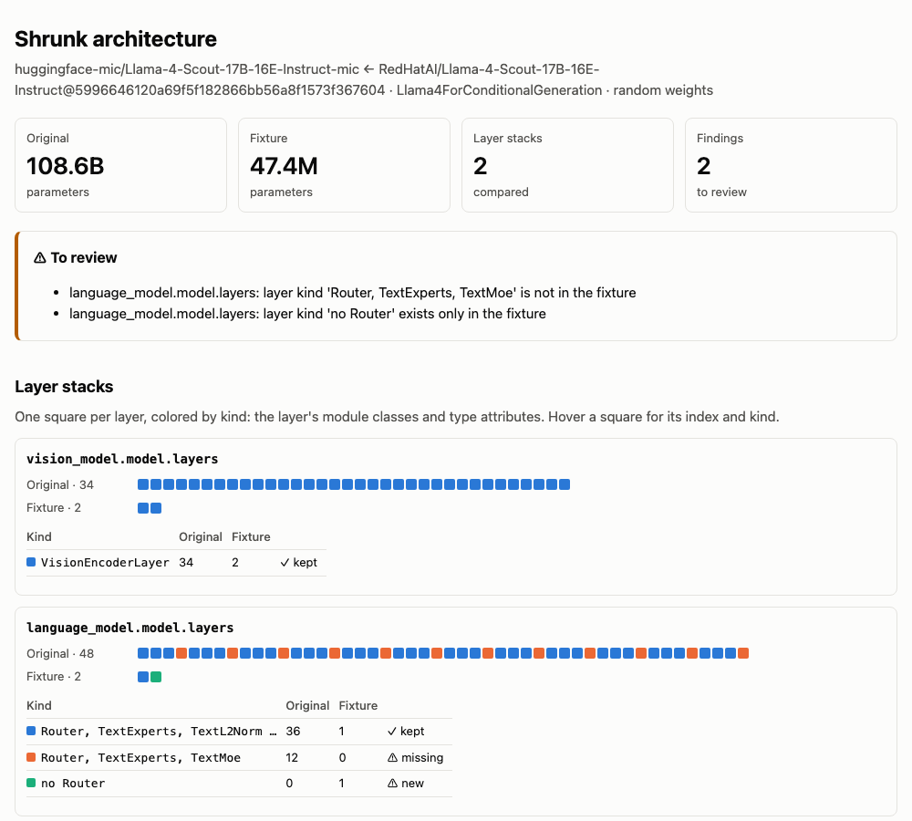

# transformers-mic CLI

`transformers-mic` packages the existing MIC runner, fixture builder, replay tools,
and reviewed catalog. Start with the fixture:

```sh
tmic fixture org/model --open
```

shrinks a Hub checkpoint to a tiny config and weights and compares both with the
source, with no workspace, contract or LLM ([details](#check-the-tiny-model-before-building-it)).
Then `tmic run org/model` creates a working directory around that fixture, drafts
the usage path, and measures expectations there.
It is an alpha implementation: generated plans still need code review and a
working model-specific build recipe. New projects use one repository,
`huggingface-mic/<name>-mic`, for fixture weights, the contract, usage and reviewed
framework expectations. See [the Hub layout](hub-organization.md).

## For coding agents

Paste this into a coding agent with the model id filled in. It runs everything
locally and uploads nothing:

```text
Create a model integration contract (MIC) for the Hub model <MODEL_ID> with tmic,
locally, uploading nothing. Read the "For coding agents" section of
https://github.com/huggingface/transformers-mic/blob/main/docs/cli.md first,
then `tmic run --help`.

1. In a Python 3.11+ venv:
   pip install "transformers-mic[runtime]" "hf-doc-builder @ git+https://github.com/huggingface/doc-builder.git"
   Check `hf auth whoami`; if it fails, ask me to run `hf auth login`.
   Check that <MODEL_ID> exists on the Hub. Fix a wrong id, don't guess one.
2. Run: tmic run <MODEL_ID> --mode agent --local-only --fixtures-only --no-history --bill-to ''
   Then loop until exit 0: read the JSON on stdout, answer the pending question
   per the rules in that section, and run the `resume` command it gives with
   --answer <file>.
3. Ask me before approving fixture-review, source-review, contract-repair or
   baseline-change. For fixture-review, show me its `details` (config changes and
   serialized weight names); to change the config, edit `fixture/config.json` in
   the workspace and resume.
   Never edit a tolerance, an expectation or a gate to make a step pass.
4. When it exits 0, report: the workspace path, what the contract calls,
   the weights choice (random or overfit) and why, the platform the
   baselines were recorded on, and the `tmic shrink` findings for the fixture.
```

Everything below is the reference that prompt points to.

**Interface.** `tmic run --mode agent` drives the whole pipeline without reading
stdin: it drafts the contract, builds the fixture, records and reviews baselines,
and checks them. stdout carries one JSON result; progress goes to stderr, and
each stage's full log is in `.mic/automation/logs/`. The same command resumes
from where it stopped.

| Exit | Meaning | Do |
|---|---|---|
| 0 | `status: "validated"` (local-only) or `"complete"` (published) | Report. |
| 3 | `status: "needs-input"`: answer `pending_question`. With `answer_error`, the answer was stale or reused and the current question is attached. | Answer it, then run the `resume` command. |
| 2 | Invalid invocation, state or answer file | Fix the command or file. |
| 130 | Interrupted; progress saved | Rerun the same command. |

**Answering.** Write
`{"question_id": "<id>", "answer": "<choice>", "reason": "<why>"}` to a file and
run the emitted `resume` command with `--answer <file>`. Use the emitted command,
because it keeps `--local-only` and the other options. An answer is consumed once.
`defer` always leaves the question pending.

| `kind` | What it asks | Who decides |
|---|---|---|
| `fixture-review` | Is the tiny model's config and weight format right? Asked before any contract code runs. | **Operator.** Show `details`: the config values that differ from the source, the serialized weight names (layer numbers collapsed to `{n}`) compared with the source checkpoint, and findings. `context.fixture` has the same as counts and lists. To change the config, edit `fixture/config.json` and resume without `--answer`: tmic stores your values as the recipe's `config_overrides`, shrinks again and asks about the result. |
| `source-review` | Run the drafted contract? | **Operator.** `details` holds `usage.md` itself. It is executable Python that nothing sandboxes. Summarize what it loads and calls. |
| `retry` | A stage failed | You. Read the log in `context.log` and fix the cause first. Retrying unchanged inputs pauses after two attempts. Missing dependencies and model-specific build errors are yours to fix. |
| `contract-repair` | Apply an LLM-proposed usage diff? | **Operator.** Show the rationale and diff. `reject` still uses one of the two repairs. |
| `baseline-change` | Accept changed expected values? | **Operator only.** `reason` is required. Never approve a change only to make a check pass. |
| `cloud-baselines`, `model-publication`, `fleet-update` | Upload to the Hub | **Operator only.** These never appear with `--local-only`. Uploads are public and pinned. |

New and unchanged baselines are approved automatically, so no question appears
for them.

**Workspace.** Without `--out`, the run uses `work/mic/<org>--<model>`. Inside it:

- `fixture/`: the tiny model, loadable with `from_pretrained`: `config.json`, the
  weights in the source's serialized format, and the processor files. Before the
  build it holds seeded random weights; after it, the built fixture. Edit
  `config.json` here to change the shrink.
- `example/hub/<name>-mic/integration.json` and `.../integrations/transformers/usage.md`:
  the contract.
- `example/hub/<name>-mic/integrations/transformers/expectations/<platform>/`:
  the baselines, for example `cpu-x86_64`, `cpu-x86_64-bf16` or `cuda`.
- `.mic/project.json`: the weights choice and why.
- `.mic/automation.json`: every decision.
- `tmic shrink --open` (from the workspace) shows what the fixture kept from the
  checkpoint ([details](#how-was-the-fixture-shrunk)).

**Limits worth knowing before you start:**

- A model in the bundled catalog makes no LLM call. Otherwise the draft comes from
  Inference Providers, and `--bill-to ''` bills the user's own HF account
  ([When the LLM is used](#when-the-llm-is-used)).
- `--fixtures-only` never loads the real checkpoint. Drop it only when the
  operator wants real-checkpoint targets and the machine fits the model.
- Local baselines cover only the platform they ran on. Baselines from a Mac do
  not help Transformers PR CI, which reads `cpu-x86_64` and `cpu-x86_64-bf16`.
  Maintainers produce those with cloud runs ([Cloud baselines and publication](#cloud-baselines-and-publication-maintainers)).
- A green check proves the contract reproduces its own baselines. It does not
  prove the baselines are right: read the candidate values. Batch rows should
  differ, variants should agree, and losses and gradients should be finite.

## Install

Python 3.11+:

```sh
pip install "transformers-mic[runtime]" "hf-doc-builder @ git+https://github.com/huggingface/doc-builder.git"
hf auth login        # publishing needs write access to the target namespace
gh auth login        # history search; or pass --no-history to create
```

doc-builder comes from Git because its PyPI release lacks the runnable-Markdown
collector. To work on tmic itself, install a checkout instead:
`pip install -e '.[runtime,dev]'`.

`tmic run` measures baselines in the cloud by default, on a Transformers commit
from `main`. Its local factory check first requires the same Transformers, so
install `main` too:
`pip install "transformers @ git+https://github.com/huggingface/transformers"`
(the check names the exact command when it stops). `--local-only` runs need no
such install.

## Dashboard authentication

```sh
tmic auth login
tmic auth status
tmic auth logout
```

Login opens the Transformers CI dashboard. Sign in with GitHub, compare the code
with the one printed in your terminal, and explicitly authorize tmic. On SSH,
use `tmic auth login --no-browser` and open the printed URL elsewhere. Use
`--dashboard https://dashboard.example.com` on each auth command for another
deployment.

Dashboard access lasts eight hours and can be revoked from your profile. The
CLI stores its dashboard credential in
`~/.config/transformers-mic/dashboard-auth.json` (or under `$XDG_CONFIG_HOME`),
with file permissions `0600`. It stores no GitHub token and uses neither
Grafana nor your local `gh` login. Logout revokes the server session before
removing the local credential; connection failures leave it available to retry.

This authenticates the CLI for the remote baseline service below. Workflow
dispatch also requires repository write access. Baseline approval and publication
remain explicit operations; the auth commands themselves do not execute a job.
Local Hub publishing uses `hf auth login`; direct workflow publication uses the
operator's dedicated Hub write secret.

**Activation is pending:** browser OAuth needs the existing GitHub App's callback
URL/client secret, and Serge's App must be installed on `transformers-mic`.
Until then, use the GitHub-authenticated workflow test below.

## Cloud baseline collections

After dashboard activation, one command can measure the entire pinned collection
on the dashboard/Serge ARC runners and retrieve models and candidate baselines:

```sh
tmic baselines run --out work/baselines
# Or have the workflow upload directly, returning only the Hub revision:
tmic baselines run --out work/baselines-hub \
  --upload-repo huggingface-mic/baseline-candidates --no-download
```

The CLI shows remote stages and per-profile case counts. Repeat the same command
to resume the same job. See [cloud baselines](cloud-baselines.md) for local versus
cloud execution, artifact retrieval, direct or local Hub upload, baseline review,
Hub model PRs, and operator setup. These commands refresh the shared fleet's
existing immutable fixtures; new model creation still uses the workflow below.

```sh
# Explicitly narrow the scope for a first dashboard test:
tmic baselines run --out work/smoke --fleet control --fixtures-only
tmic baselines status --out work/smoke
# Inspect downloaded measurements, then preview a dataset upload:
tmic baselines review --out work/smoke
tmic baselines upload --out work/smoke --repo my-org/baseline-results
# Add --execute to upload. Canonical model changes use reviewed Hub PRs:
tmic baselines publish --out work/smoke
```

### Temporary test without dashboard OAuth

From the repository root, with MIC installed in the active Python environment:

```sh
gh auth login
python tools/try_cloud_baselines.py --out work/arc-smoke
```

This uses your `gh` identity and repository permissions to dispatch the real ARC
workflow directly, watches Actions job/step progress, downloads CPU/CUDA artifacts,
and validates their provenance and checksums. It defaults to the control fleet's
fixtures. Repeat the same command to resume; it never automatically repeats an
ambiguous dispatch. Use a separate `--out` for another collection. Resume these
test collections with the helper, rather than `tmic baselines run/status`.

To request both fleets and real checkpoints:

```sh
python tools/try_cloud_baselines.py --out work/arc-all \
  --fleet all --include-checkpoints
# Optional direct Hub upload (requires the workflow's scoped write secret):
python tools/try_cloud_baselines.py --out work/arc-hub \
  --upload-repo huggingface-mic/baseline-candidates
```

The downloaded collection works with `tmic baselines review/upload/publish`.

`tmic baselines run --transport github --exclude <Contract>` (repeatable) leaves a
fleet contract out of the collection, for example while an open upstream bug makes
its fixture unmeasurable. Its published baselines are not touched, and the
exclusion is recorded in the collection's provenance.
Repository image variables must be configured first; direct upload also needs
`MIC_BASELINE_WRITE_TOKEN` in the `mic-publish` environment. This tests GitHub Actions/ARC and artifact retrieval;
it does not test dashboard/Serge authorization or the live case-progress relay.
There is no anonymous endpoint or production auth bypass. See
[operator setup](cloud-baselines.md#operator-setup) for the full service path.

## Automated mode

### Try it locally

Everything runs on your machine and nothing is uploaded. Use your source
checkpoint in place of `org/model`:

```sh
pip install "transformers-mic[runtime]" "hf-doc-builder @ git+https://github.com/huggingface/doc-builder.git"
hf auth login
tmic fixture org/model --open      # 1. the tiny config + weights, compared with the source
tmic run org/model --local-only --fixtures-only --no-history --bill-to ''   # 2. the contract
```

Step 1 writes `./model-fixture/` and needs no contract or LLM; edit
`fixture/config.json` there and rerun until the tiny model looks right. Run step 2
from the same directory: it keeps that fixture's revision and `config_overrides`
(`tmic: using the reviewed fixture recipe …`). `--fixture-recipe DIR` points at a
folder elsewhere.

`tmic run` drafts the contract, then asks you two things before it runs anything:

1. **Review tiny model.** It shrinks the checkpoint's config and writes the tiny
   model to `work/mic/org--model/fixture/`: `config.json` and the weights in the
   checkpoint's own serialized format (seeded random values; no contract code has
   run). The prompt lists the config values that differ from the source and
   compares the serialized weight names with the source checkpoint's. `D` shows
   all of it. To change something, edit `fixture/config.json` (or press `E`):
   tmic shrinks again with your values and asks again.
2. **Review contract.** `D` shows `usage.md`, the Python the checks execute.

Then it builds the fixture (checking the weights move the contract's outputs),
records baselines and checks them. New baselines need no review. The flags:

- `--local-only`: measure on this machine and stop before any Hub upload.
- `--fixtures-only`: declare only the fixture as a target, so the full
  checkpoint is never loaded.
- `--no-history`: skip the GitHub history search, so `gh` is not needed.
- `--bill-to ''`: a new model's draft comes from an LLM through Inference
  Providers ([When the LLM is used](#when-the-llm-is-used)); this bills your own
  account instead of the `huggingface` organization. A model in the bundled
  catalog makes no LLM call.

Repeat the same command to resume. The workspace is created in
`work/mic/org--model` under the current directory. The contract is in
`example/hub/<name>-mic/` there (`integration.json` and
`integrations/transformers/usage.md`); the tiny model is in `fixture/`. Progress, prompts and repairs below work the same way
locally. The cloud, dashboard and GitHub options in this document are for
maintainers who publish to `huggingface-mic`.

### Cloud baselines and publication (maintainers)

```sh
tmic run org/model
```

**Baseline measurement runs in the cloud by default.** Contract creation and
fixture building happen locally. Then `tmic run` uses `tmic baselines run` for
this model on cloud CPU and CUDA runners, covering every declared target and
variant. It stages an immutable input on a `tmic-baselines/<source-hash>` Hub
branch, retrieves and independently verifies the measured candidates, and uses
the existing review/publication flow. The model's main branch and fleet pins
change only after review. Cloud input requires the single `<name>-mic` layout
and an operator-approved Hub namespace (default `huggingface-mic`).

Until dashboard activation, use your GitHub CLI identity for the same model flow:

```sh
tmic run apple/mobilevit-xx-small --baseline-transport github
```

This directly dispatches Actions/ARC using `gh auth login`, without using the
dashboard/Serge path. Your HF login needs permission to stage the model snapshot
and, when approved, publish to the selected namespace. New model drafting also
uses your configured HF inference provider. To measure locally instead:

```sh
tmic run org/model --baseline-execution local
```

`--local-only` also selects local execution and stops before any Hub upload.
Cloud progress appears on stderr; `--baseline-timeout` defaults to six hours.
Repeat the same command to resume the persisted cloud job. Missing CPU/CUDA cases,
changed source/weights, or unreviewed/edited candidates block publication.
Hardware exclusions explicitly declared in the manifest remain visible.

Without `--out`, MIC resumes the matching model workspace in `work/*` or
`work/mic/*`, including custom names such as `work/mobilevit-e2e`. If more than
one matches, it lists them and requires `--out`. An explicit `--out` or
`--workspace` takes precedence, as does running inside a MIC workspace.
With no existing match, it creates `work/mic/org--model` and runs the same measured
workflow as the individual commands: reuse or draft the contract, select/build
weights, check Auto-model registrations, record reproducible candidates for every
declared variant, review them, validate all targets, publish the model snapshot,
validate its published pins, and update the shared fleet dataset. The default fleet
is `prototypes`; use `--fleet control` for the control fleet.

The command asks you to review the executable contract before building it. It
automatically approves only new or unchanged candidate baselines, using the
existing review rules. Changed baselines show a diff and need your confirmation
and an explanation, saved with file hashes in `.mic/automation-reviews.json`.
It previews each upload and asks before publishing the model or updating the fleet.
An intervening dataset update requires a fresh preview and decision.

```sh
# Validate locally, without uploading:
tmic run org/model --local-only
# Choose a workspace and write the final dataset SHA into a framework checkout:
tmic run org/model --out work/my-model --transformers-checkout /path/to/transformers
# For a new model, declare only fixture targets:
tmic run org/model --fixtures-only
```

Declared variants and targets are not silently dropped. Catalog contracts keep
their existing target scope, which can include real checkpoints. Use a runtime
that supports those variants. Model-specific build errors, missing dependencies,
and unsupported hardware stop progression and show the stage log; fix the problem
and retry. `--timeout SECONDS` bounds each stage (default 1800). New models use the
HF planner just as `create` does; `--no-history`, `--provider`, `--llm-model`,
`--weights`, `--namespace`, `--contract`, `--name`, and `--regenerate` are available.

Repeat the same command to resume. State lives in `.mic/automation.json`; logs
live in `.mic/automation/logs/`. Completed uploads are not repeated when resuming
an unchanged workspace. Source, lock, or baseline edits invalidate earlier checks
and restart validation. After `--local-only`, rerun without it to continue through
publication. No Git commit or framework PR is created automatically.

### Reading progress and answering prompts

Human mode numbers only the work remaining in this invocation. A resumed build
starts at step 1; completed review and an unrequested fleet-pin step are excluded.
Completed local stages collapse to one line in a terminal, with an activity
indicator and the actual build phase while running. Overall bars count stages,
cloud bars count completed workflow steps or measured cases; they do not estimate
elapsed-time completion.

Questions use indentation and color, with long details folded by default. Press
`D` to open the complete details or diff (quit the pager to return to the same
question). This does not approve the question. Color is disabled for redirected
output, `TERM=dumb`, or `NO_COLOR`.

Cloud jobs refresh a single block instead of repeating GitHub's JOBS section.
Before staging cloud inputs, the factory-check step executes every declared
variant against the built fixture locally, without comparing numeric baselines.
Failures enter the bounded, reviewed contract-repair flow before GPU dispatch.
This catches errors such as floating inputs left in float32 for bfloat16 weights;
it does not replace measurement and validation on the cloud CPU/CUDA environments.
Before it runs (`tmic auto --match-cloud`), tmic compares this Python with the
cloud runners' and stops with the exact `pip install` command when:

- a package of the `runtime` extra is missing or at an excluded version. The cloud
  images get the same list from Transformers' `testing` extra, which installs
  `transformers-mic[runtime]`;
- Transformers is a release, or an install with no commit to trace (a `git+`
  install records its commit; a local source tree is asked with `git`). The cloud
  measures a `main` commit, resolved at dispatch.

A Transformers commit other than the current `main`, or a source tree with
uncommitted changes, only prints a note: `main` moves several times a day, and
the dispatch resolves it again anyway. Set `TMIC_ALLOW_ENVIRONMENT_DRIFT=1` to
continue past a stop and see the factory check's own result.
The display distinguishes waiting for a runner, dependency installation,
measurement and completion, with a run link, a small animation and elapsed timer.
Animation is rendered in the parent CLI so carriage returns survive the child
process relay. Redirected logs contain plain text only when status changes.

With the GitHub baseline transport, Ctrl+C stops the local watcher and asks
whether to cancel the remote CPU/CUDA workflow. Answer `y` to request cancellation,
or `n` (the default) to leave it running and reconnect with the same command.
This question requires its own answer even after choosing `A=always` earlier.
Agent mode and noninteractive input leave the remote run running. After GitHub
confirms cancellation, the next run archives the old collection and starts fresh.

Human mode shows short failure explanations. Complete tracebacks and worker output remain in the shown
log files. Pausing prints a resume command; agent mode keeps its JSON protocol.

`D` prints the full details inline (for the contract review: the code itself), then
asks again. At the tiny-model review, `E` opens `fixture/config.json` in the editor
git would use: `$VISUAL`, `$EDITOR`, git's `core.editor`, then the first of `nano`,
`vim` or `vi`. Use a waiting command for a GUI editor (`EDITOR="code --wait"`). When
you save and quit, tmic shrinks again with your values and asks about the result.
If no editor starts, it waits while you edit the file elsewhere and press Enter.

At `Continue? [y/N/A=always/D=details]`, choose `A` (or `a`/`always`) to approve this and
later questions in the current process. This includes source/repair reviews,
baseline decisions, model publication and fleet updates. Every decision remains
in the audit log and links to your original Always authorization. Changed
baselines receive an explicit audit note that you chose Always for this invocation.
A new CLI process asks again; this preference is not persisted across restarts.

Always does not change validation rules or repair limits. After two automatic
retries of the same failing stage with unchanged workspace inputs, the run pauses
instead of looping. Fix the cause, then resume the printed command.

### Bounded contract repair

When a generated contract fails during build, factory checks or measurement,
`tmic run` can inspect the failure and draft a repair. It reads the pinned
architecture's parameter names/shapes on the meta device (without loading its
weights), plus the bounded failure log, current usage and manifest. The configured
HF planner proposes a change; the CLI displays its rationale and usage diff and
asks for approval **before** applying it. An approved repair backs up the old
source, forces a fixture rebuild, and reruns gates and measurements.

The manifest must remain byte-equivalent as JSON: output rules/tolerances, targets,
variants, resources and build recipes cannot change. Explicit assertions and
training gradient/update checks are preserved structurally. Review the code diff
for semantic changes; automated checks cannot prove arbitrary Python equivalent.
No failed measurement is converted to a pass, and no gate is bypassed.

The default limit is two proposals per workspace, including rejected or interrupted
attempts. `--max-contract-repairs 0` disables this; the accepted range is 0–5.
When the budget is exhausted or a proposal fails validation, the ordinary manual
retry prompt remains. Network/access errors retain the normal retry path.
Proposal JSON, diffs, log/source hashes, backups and decisions are retained under
`.mic/automation/repairs/` and `.mic/automation.json`. Resuming a pending repair
reuses the saved proposal rather than making another provider call. Editing the
source, log or proposal invalidates approval.

Agent mode emits a `contract-repair` question using the same one-use answer
protocol as other decisions. Answer `approve` to apply the displayed diff,
`reject` to decline it (it still counts toward the repair limit; the failed
stage then offers the ordinary retry), or `defer` to leave the question pending.
In human mode, `R` rejects. As with other questions, obtain the operator's
decision before approving.

### Human and agent modes

```sh
tmic run org/model --mode human   # default: interactive terminal
tmic run org/model --mode agent   # JSON protocol, no stdin reads
```

Both modes use the same workspace and decisions. You can switch modes when
resuming. `tmic --help` introduces both modes; `tmic run --help` contains the
answer format and exit codes, so an agent can discover the interface directly.
`--non-interactive` is an alias for agent mode.

In agent mode, stdout contains one JSON result and progress/log output goes to
stderr. A pending question exits **3** and includes `protocol_version: 1`,
`status: "needs-input"`, a `resume` command, and `pending_question`:

```json
{
  "question_id": "<opaque ID>",
  "kind": "source-review",
  "question": "Review the contract code before it runs.",
  "details": "Paths and review details...",
  "choices": ["approve", "defer"],
  "requires_reason": false,
  "context": {"workspace_sha256": "<hash>", "files": []},
  "context_sha256": "<hash>"
}
```

The first question of a new model is `fixture-review`. Its `context.fixture` is the
comparison in structured form, and `details` is the same text a human sees:

```json
{
  "kind": "fixture-review",
  "choices": ["approve", "defer"],
  "context": {
    "fixture": {
      "folder": "/abs/work/mic/org--model/fixture",
      "model_class": "MistralForCausalLM",
      "weights_file": "model.safetensors",
      "parameters": {"original": 7241732096, "fixture": 2104320},
      "config_changes": 6,
      "weight_names": {"matching": 12, "only_source": [], "only_fixture": []},
      "findings": []
    },
    "config": {"path": "/abs/.../fixture/config.json", "sha256": "<hash>"},
    "review": {"path": "/abs/.../.mic/fixture-review.json", "sha256": "<hash>"}
  }
}
```

To change the tiny model, edit `context.config.path` and run the `resume` command
**without** `--answer`. tmic applies the edit, shrinks again and returns a new
`fixture-review` question with a new `question_id`. An answer to the old id comes
back with `answer_error` and the new question attached. `.mic/fixture-review.json`
holds the full lists (`source_keys`, `fixture_keys`, `config_changes`) when an
agent needs more than the summary.

Inspect the context and referenced files or diffs. Obtain the operator's decision
when needed, then write a JSON answer file:

```json
{"question_id": "<ID from pending_question>", "answer": "approve", "reason": "Reviewed the displayed snapshot"}
```

Run the emitted resume command with `--answer answer.json`. For example:

```sh
tmic run org/model --mode agent --out work/mic/org--model --answer answer.json
```

Use the **emitted command** to preserve options such as `--local-only`, fleet,
namespace and timeout. The answer file is deliberately absent from that command:
each accepted answer is consumed once, and the next question needs another
answer. Retry questions offer `retry` or `defer`; contract repairs offer
`approve`, `reject` or `defer`; other questions offer `approve` or `defer`. Changed-baseline approvals require a nonempty `reason`. `defer`
leaves the question pending and performs no approved action.

Questions bind the workspace snapshot, stage, selected destination, relevant
file hashes and, for fleet updates, the exact dataset base revision and pins.
Polling an unchanged question preserves its ID. Stale or reused approvals exit
**3** with `answer_error` and the current question; approval is never transferred
to another snapshot. Malformed answer files or answers without a pending
question exit **2**. Decisions and their contexts are recorded in
`.mic/automation.json`; changed-baseline explanations also retain their file-hash
receipts. A workspace lock prevents simultaneous runs consuming the same answer.

A successful local-only run (`status: "validated"`) or publication
(`status: "complete"`) exits **0**. Ctrl-C stops stage processes, saves progress
and exits **130**. Invalid invocations/state exit **2**; command-line syntax
errors use the normal argparse error output. Existing individual commands remain
available; `tmic auto` still checks factory mappings for a built fixture.

## Step by step: one model

**The order is: real checkpoint → fixture preview → contract → built fixture.**
You start from a real checkpoint id. `tmic fixture org/model` previews the
fixture: the shrunk config, tensor names and file format are final there, the
weights are seeded random values. `create` writes the contract (the usage code
and manifest), keeping the preview's revision and `config_overrides`
(`--fixture-recipe`), and `build` then derives the fixture's weights. `build` needs
the contract because it accepts weights only after the contract's inputs move the
outputs (the sensitivity gate).

1. **Create the workspace from the real checkpoint.**

   ```sh
   tmic create google-bert/bert-base-uncased --out work/bert --namespace huggingface-mic
   cd work/bert
   ```

   `--namespace` sets the owner of the single `<name>-mic` repository.
   It defaults to `huggingface-mic`; an explicit owner overrides that default.
   Nothing is uploaded until publication. The workspace holds usage and candidate
   references locally; reviewed expectations belong under
   `integrations/transformers/expectations/<platform>/`, alongside `usage.md`.

   If the checkpoint is in the bundled catalog, this reuses the published
   contract and needs no LLM call. Add `--regenerate` to build a new
   `<name>-mic` fixture instead of reusing the published one. If the checkpoint
   is new, the planner drafts the contract on your HF token (see
   [When the LLM is used](#when-the-llm-is-used)). By default the contract
   covers both the real checkpoint and the fixture. Use `--fixtures-only` to
   declare a slim-only contract.

2. **Read the draft.** Open `integration.json` and
   `integrations/transformers/usage.md` in the workspace's MIC model directory
   (`example/hub/<name>-mic/`) before running anything. The usage is executable
   Python, and nothing sandboxes it.

3. **Build the fixture.**

   ```sh
   tmic build
   ```

   This shrinks the real config, copies the processors byte for byte and tries
   random weights first. If the gates fail, it tries a bounded overfit. If both
   fail, the build is rejected. `.mic/project.json` records which weights won
   and why ([Random or overfit?](#random-or-overfit)).

   For models with fixed geometry or processor tensors, add reviewed entries to
   the fixture's `build` recipe before this step. For example:

   ```json
   {
     "copy_assets": ["attention_mask.safetensors"],
     "preserve_frozen_prefixes": ["model.geometry."]
   }
   ```

   `copy_assets` names extra files copied byte for byte from the pinned source.
   `preserve_frozen_prefixes` copies matching parameters and persistent buffers
   only when they have `requires_grad=False`; missing names and shape changes
   fail the build. Their source hashes are included in the fixture key and build
   record. The planner cannot add these options; review and edit the recipe yourself.

   Then check that the fixture keeps the spirit of the original with
   [`tmic shrink --open`](#how-was-the-fixture-shrunk).

4. **Record the candidate expectations.**

   ```sh
   tmic record --all-variants
   ```

   Every case runs twice, each time in a fresh process, and the results are
   written to `integrations/transformers/expectations/<platform>/*.candidate.json`
   in the same MIC model directory as the usage.

5. **Review and approve them.**

   ```sh
   tmic review
   tmic review --approve
   ```

   `--approve` accepts only new and unchanged values. Changed values stay
   pending until someone approves them by hand.

6. **Check the approved expectations.**

   ```sh
   tmic check --all-variants
   tmic status
   ```

7. **Publish to the Hub.**

   ```sh
   tmic publish                 # preview the destinations
   tmic publish --execute       # upload; the lock is rewritten to immutable revisions
   tmic check --all-variants    # publishing invalidates receipts: check the published pins
   ```

   Uploads are public and pinned, so this step is outward-facing.

8. **Update the shared fleet and pin Transformers.**

   ```sh
   tmic export --fleet prototypes
   tmic export --fleet prototypes --execute --transformers-checkout /path/to/transformers
   ```

   The first command previews the update; `--execute` uploads it to the
   [`huggingface-mic/transformers-fleet`](https://huggingface.co/datasets/huggingface-mic/transformers-fleet)
   dataset. Only `tests/contracts.lock`, containing the dataset commit SHA, is
   written into Transformers. Expectations stay beside usage in the pinned model.
   Review and commit the pin change in your framework PR.

### Sentence Transformers

Install the optional ST dependency with `pip install -e '.[runtime,sentence-transformers]'`.
Add `--sentence-transformers` to `create` or `run` to use ST's public inference APIs:

```sh
tmic run sentence-transformers/all-MiniLM-L6-v2 \
  --sentence-transformers --namespace my-namespace \
  --local-only --fixtures-only --no-history
```

The flag accepts `SentenceTransformer`, `CrossEncoder`, `SparseEncoder`, or
`MultiVectorEncoder`. Without a value, the CLI infers the class from saved model
metadata. These contracts generate encoding and scoring examples without a
planner call. Fixture creation requires the Transformers config at the repository
root.

The contract declares only the `sentence_transformers` integration
(`integrations/sentence_transformers/usage.md`, baselines under
`integrations/sentence_transformers/expectations/`). So Transformers lanes skip it,
the Sentence Transformers nightly selects it once the fleet lists it, and
Transformers known failures and local patches never apply. `tmic record`, `check` and
`review` default to a contract's only integration, so no `--integration` is needed.
The fixture is the complete ST pipeline: a shrunk random backbone with Pooling and
Dense dimensions resized to match, gated by the same sensitivity, fitting and
numeric-health checks as other fixtures. `tmic integrations` (above) is still the way
to add the ST usage to an existing Transformers MIC.

For batch creation, set `sentence_transformers_class` on each model entry.

## Several models at once

List the models in a JSON file shaped like `experiments/proto-models.json`, with
`name`, `model_type` and `checkpoint` for each entry. Then:

```sh
tmic batch --models-file my-models.json --out work/fleet --phase prepare --no-history
tmic batch --models-file my-models.json --out work/fleet --phase run --resume
```

`prepare` runs step 1 for every model, always with `--regenerate`. Read the
drafts in `work/fleet/projects/*/` before you start `run`, which does steps 3–6. `run`
calls `review --approve` itself, so you do not get a manual review there:
inspect the approved expectations before you publish. `batch` keeps going past
failures and records every stage. `--select NAME` reruns one model. `--publish`
adds step 7, and it uploads only after all declared checks pass.

Use a checkout pinned to the workspace's `fleet.lock` dependency environment for
baseline reproduction. Installing the runtime extra alone does not freeze that
environment. The repository's GPU workflow uses `.github/scripts/install_pinned.sh`.
The PyPI release of doc-builder currently lacks the runnable-markdown collector;
install its Git version as above. The installed wheel bundles the backend and
catalog, so it also works outside this checkout; model weights download from the
immutable Hub pins.

`tmic create --offline` reuses a catalog contract without network requests.
Otherwise, `gh` must be installed and authenticated for GitHub history searches.
`--no-history` skips them; `--history-file failures.json` imports a normalized JSON
list from relore or another source. A failure object can contain `url`, `title`,
`body`, and revision information. Searches are bounded candidates, not a complete
inventory of past failures, and do not count as regression detection.

## Check the tiny model before building it

```sh
tmic fixture org/model  # no workspace: shrink a Hub checkpoint into ./model-fixture/
tmic fixture            # write fixture/ and compare it with the source
tmic fixture --open     # also open the layer-by-layer comparison page
tmic fixture --json     # counts and lists, for scripts and agents
```

With a Hub repo (`org/model[@revision]`, `--out DIR`), `tmic fixture` needs no
workspace, contract or LLM: it pins the revision, shrinks with a fresh recipe and
writes `fixture/`, `.mic/fixture-review.html` and `.mic/recipe.json` (source, pin,
recipe) into the folder. Rerunning reuses the pin; edits to `fixture/config.json`
become `config_overrides` in `recipe.json`. The weights are seeded random values: the
build, which needs a contract, is what checks them. `tmic run org/model` (or
`tmic create --fixture-recipe DIR`) carries the recipe into the contract: it pins the
same revision and adds the `config_overrides`, so the build shrinks with your values.
`tmic run` finds `./<model>-fixture/` by itself. Without a repo, `tmic fixture` works
on the current workspace's fixture, as below.

`tmic fixture` shrinks the config and writes `fixture/` in the workspace without
running any contract code: `config.json`, the weights in the source checkpoint's
serialized format (same tensor names, prefix and file type), and the processor
files. It prints the config values that differ from the source, the weight names
with layer and expert numbers collapsed to `{n}`, sorted into names that match the
source, names only in the source (heads the model class does not have, or a
quantized source's scales: the tiny model is dense), and names only in the tiny
model, plus the `tmic shrink` findings. An `Experts:` line says how routed experts
are serialized on each side: per-expert tensors (with the count) or fused stacks.
The weight names and expert layout follow the source checkpoint and cannot be
edited; a mismatch points at the checkpoint conversion, not the config. The file
is always `model.safetensors`, even when the source ships `pytorch_model.bin`.

Edit `fixture/config.json` and rerun to change the shrink: changed or added values
become the recipe's `config_overrides` in `integration.json` (dotted paths for
sub-configs such as `text_config.hidden_size`). `tmic run` does the same when it
resumes. After the build, `fixture/` holds the built fixture; editing it then sends
the run back to this review.

- Only changed or added values are kept. Deleting a field does nothing; to drop
  one, set it to `null` under `config_overrides.fields` in `integration.json`.
- A field must exist in the model's config class, or the shrink fails with
  `the shrunk config has no field X` and the run offers a retry.
- Some values are derived from others; check the new comparison to see what took
  effect.

## How was the fixture shrunk?

`tmic shrink` shows whether a fixture keeps the spirit of its checkpoint. It
builds the source checkpoint and the fixture on the meta device from their configs
(no weights are downloaded), compares the modules Transformers builds, and writes
`shrink-<fixture>.html`.

```sh
tmic shrink --open                                     # the workspace's fixture, opened in a browser
tmic shrink huggingface-mic/gemma-3n-E2B-it-mic        # any published fixture
tmic shrink huggingface-mic/Llama-4-Scout-17B-16E-Instruct-mic@<revision> --html llama4.html
tmic shrink ./fixture-dir --source org/model@<revision> # a local build whose build.json names no source
tmic shrink huggingface-mic/resnet-18-mic --json | jq '.stacks[].kinds'
```

The summary goes to stderr. A clean fixture:

```text
huggingface-mic/gemma-3n-E2B-it-mic <- google/gemma-3n-E2B-it@5e092eb… (Gemma3nForConditionalGeneration)
parameters: 5.4B -> 581.1M
model.language_model.layers: 30 -> 4 layers (sliding_attention 24->2; full_attention 6->2)
model.audio_tower.conformer: 12 -> 12 layers (AudioConformerBlock 12->12)
0 finding(s)
```

A fixture that lost a layer kind, from before the shrink rule was fixed: Llama 4
Scout's `moe_layers` is an index list as long as the depth, so the rule sliced it
like a per-layer list and built a dense layer instead of MoE.

```text
huggingface-mic/Llama-4-Scout-17B-16E-Instruct-mic <- RedHatAI/Llama-4-Scout-17B-16E-Instruct@5996646… (Llama4ForConditionalGeneration)
parameters: 108.6B -> 47.4M
vision_model.model.layers: 34 -> 2 layers (VisionEncoderLayer 34->2)
language_model.model.layers: 48 -> 2 layers (Router, TextExperts, TextL2Norm … 36->1; Router, TextExperts, TextMoe 12->0; no Router 0->1)
2 finding(s)
  - language_model.model.layers: layer kind 'Router, TextExperts, TextMoe' is not in the fixture
  - language_model.model.layers: layer kind 'no Router' exists only in the fixture
```

The rebuilt fixture keeps both kinds: 108.6B → 44.7M parameters, vision 34 → 2
layers, language 48 → 4 layers, 0 findings
([published report](https://huggingface-mic-mic-coverage.static.hf.space/shrink/Llama-4-Scout-17B-16E-Instruct-mic.html)).
The screenshot below is the old fixture.



The page shows:
- **Layer stacks:** one square per layer, colored by kind. A kind is the layer's
  module classes plus its `layer_type`/`attention_type`; dropout and drop-path are
  ignored. Hover a square for its index.
- **Where the parameters are:** each component's share. The vocabulary and patch
  sizes are kept, so embeddings usually dominate the fixture.
- **Preserved properties:** attention style (MHA/GQA/MQA), MoE routing, vocabulary,
  tied embeddings, activation, RoPE.
- **Module classes**, and **config changes** field by field.
- **Model tester (advisory):** the model's own small test config in Transformers
  (`ModelTester.__init__`), compared with the fixture: per-layer kinds the tester
  covers that the fixture lacks, and sizes it shrinks that the fixture keeps.
  Testers are usually representative but not always, so these are notes for review.

The findings list what the original has and the fixture lost, plus two source
checks: a fixture that keeps half or more of its source's parameters (the rule did
not apply), and a source that is another project's untrained test model
(`tiny-random-*`, a `*-testing` org). A source of 20M parameters or fewer is kept
whole with its trained weights (`real weights` on the page), so it is not flagged.
Fix one with a
reviewed `config_overrides` entry or a shrink rule, then
`tmic build --rebuild --reshrink`. The builder runs the same layer-kind
comparison, so a new fixture keeps every kind of its checkpoint's layers (see
the [recipe](fixtures.md#recipe)). A fixture built before the shrink rule
existed says so on the page: its changes were chosen by hand.

## When the LLM is used

Catalog reuse requires no inference call. For a new model, or with `create --llm`,
the planner uses **Hugging Face Inference Providers**, default model
**`deepseek-ai/DeepSeek-V4-Pro-0813`**, with `provider="together"` and thinking
disabled. It replaced `deepseek-ai/DeepSeek-V4.1-Flash-1017` on 2026-11-05: in
`planner-eval` it built as often (26/48 against 27/48) and had far more drafts
accepted (45/48 against 33/48), so it made fewer calls and cost less on together,
which bills each call at least $0.01. Set `--provider` or `--llm-model` on `create` and `update` to override them. Authentication uses the normal HF token
(`HF_TOKEN` or `hf auth login`) with Inference Providers permission.

Planner calls are billed to the **`huggingface` organization** by default: each
request names it (`bill_to`), since the Hub has no organization-wide default. Set
`--bill-to <org>` or `TMIC_BILL_TO` to bill another organization you belong to, or
`--bill-to ''` to use your own account's credits. If the organization refuses the
charge, tmic stops and says so; it never falls back to personal billing.

The planner receives checkpoint config, the manifest schema, failure candidates,
one real parameter name per layer kind (layer indices written `N`, since the fixture
and the checkpoint number layers differently), and an example: the **closest approved
contract** in the control and prototype fleets. Closeness ranks the same architecture
class, then the same `model_type`, then shared sub-config types (Mistral-Large-4's
Pixtral tower → Mistral3), the model family (`deepseek_v32` → `deepseek_v3`), the
input modality (`input_features`, `pixel_values`, `input_ids`) and the head; tmic
prints the choice (`planner example: …`) and falls back to BERT when nothing matches
or the fleet is unreachable. The first draft is greedy (temperature 0), so the same
inputs give nearly the same draft; retries sample (0.7) so a rejected draft is not
repeated. It proposes a manifest and runnable usage, stored in `.mic/plan.json`.
Invalid drafts are returned with the validation error and the draft itself, up to
three attempts; persistent errors stop creation without executing the draft. It cannot generate expected numeric values, loosen tolerances, or choose overfit weights. Review generated `integration.json` and `usage.md` before running them: syntax/schema checks do not sandbox Python. `create` alone does not execute the proposed model code; `--build` and `--record` are explicit execution shortcuts.

Measure a planner or prompt change with the `planner-eval` workflow, never with a
single run: it repeats `tmic run --llm` per model with no repairs and no history
search, hides each model's own approved contract (`TMIC_EXAMPLE_SKIP_SELF=1`), and
reports create and build pass rates:

```sh
gh workflow run planner-eval.yml --repo huggingface/transformers-mic --ref <branch> -f repeats=3
```

To run `tmic run <model>` on a clean cloud runner instead, use `tmic-run.yml`. It
drafts the contract with a read-only token and uploads the workspace and the fixture's
shrink page. If every CPU case passes, or only cases needing missing hardware are left
out, it measures every declared case on cloud CPU and CUDA. A new contract that passes
is then published and added to the prototypes fleet. It refuses models already in a
fleet or on the Hub, and never approves a changed baseline. Publishing runs in the
`mic-publish` environment, which only `main` can use.

```sh
gh workflow run tmic-run.yml --repo huggingface/transformers-mic -f model=<org/model>                   # draft + publish
gh workflow run tmic-run.yml --repo huggingface/transformers-mic -f model=<org/model> -f publish=false   # draft only
gh workflow run tmic-run.yml --repo huggingface/transformers-mic -f model=<org/model> -f source_run_id=<id>  # publish an earlier draft
gh run download <id> --repo huggingface/transformers-mic -n tmic-shrink        # or tmic-workspace, tmic-publication
```

## Random or overfit?

1. Reuse the existing pinned fixture first. A new assertion does not automatically
   need new weights: measure and replay it on that fixture.
2. A fresh random fixture is sufficient if it passes the builder's sensitivity
   and finite-output gates for the proposed usage path.
3. The builder tries bounded overfitting when random fails. Use
   `--readable-output` or `--weights overfit` when meaningful decoded output is
   itself a requirement. `--weights random` forbids a silent overfit fallback.
4. If neither passes, the candidate is rejected. Some usage paths need a real
   checkpoint; declaring checkpoint-only targets is an explicit manifest choice.

`.mic/project.json` records the selected weights and reason; `build.json` contains
the gate evidence. A gate pass establishes usefulness for those probes, **not**
coverage of a past failure. Random and overfit can tie on historical coverage;
readability alone does not prove one detects more bugs. Legacy published fixtures
may predate gate metadata: they can be reused with reviewed baselines, but new
builds must pass the current gates.

## Add paths and prove regressions

```sh
tmic update 'Add a padded batch through the public pipeline API'
tmic record --all-variants
tmic review
tmic check --all-variants
tmic replay FIX_SHA --repo /path/to/transformers --match-output answer_logits
```

Update retains the old source under `.mic/history/` and keeps the fixture pin.
It rejects removal of existing output assertions. Retaining every existing call
is also a code-review requirement; output names alone cannot prove that. Use
`update --retrain` or `build --rebuild` only when the existing fixture is inadequate.
Builds are staged into immutable `.mic/artifacts/` directories and do not overwrite
previous approved expectations. LLM updates currently support single-checkpoint
contracts; grouped contracts can be edited directly and checked with the same CLI.

Replay archives bad/fixed Transformers revisions from a local Git repository,
executes the same contract and frozen baselines on each, and exits successfully
only for a failure on the bad revision followed by a pass on the fix. Without
`--match-output`, a catch may be on any output and needs inspection. No automatic
claim converts search results or sensitivity gates into replay evidence.

`record` runs each case twice before writing `*.candidate.json`. `review --approve`
accepts new and unchanged candidates, including added output fields. Changed or
removed existing values remain pending for manual review; the LLM never approves
them. Review new baselines for meaningful assertions before approval. `check`
uses approved files and pins; `--target` allows focused investigation, but cannot
satisfy the publication gate. Publication requires every declared variant checked
on the current sources and approved expectations. These receipts cover the
platforms actually run, not an untested CPU/GPU or dependency matrix.

## Hub and Transformers updates

`publish` previews the destination after validation. `publish --execute` delegates
to the checksum-checked MIC publisher and updates the lock to an immutable
Hub revision. It invalidates local check receipts, so check again before export.
Upload requires write access to the MIC model namespace, which defaults to
`huggingface-mic`.

`export --contract-name mic-bert` gives the destination a distinct name when
retaining an existing `BERT` contract. Export rejects names that differ only
by case.

`export --fleet control` updates the `control/` tables in the shared dataset;
`--fleet prototypes` updates `prototypes/`. The default is `control`. Each fleet
is three CSV tables the dataset viewer shows: `contracts.csv` (one row per
contract and fixture; the row with `contract_sha256` carries the contract and
its checkpoints), `environment.csv` and `known_failures.csv`. tmic converts them
to and from the JSON lock the runners read, and refuses a lock the tables cannot
hold exactly. Revisions from before the tables are read from their JSON lock
(`fleet-lock.json`, `prototype-fleet.lock`); a revision with both fails if they
disagree, which means a tmic from before the tables updated only the JSON. Exports preserve other entries and strip local paths. Environment changes must
be reviewed separately: export refuses a workspace whose lock environment differs
from the fleet's. `tmic environment --set torch=2.15.0 --set torchvision=0.29.2 --set torchaudio=2.11.1`
previews moving the environment of both fleets (they must stay equal; `--fleet`
moves one) in one dataset commit; `--execute` uploads it. It changes only
`environment.csv`: re-measure the contracts on the new environment first, and copy
the new block into each workspace lock before its next export. `tmic retire NAME --fleet prototypes --reason "..."` previews
removing one contract (and its known failures), for example one replaced by a
build from a trained checkpoint; `--execute` uploads it. Preview first, then use `--execute` to upload. A concurrent
Hub update rejects the commit; rerun to review the new state.
`--transformers-checkout PATH` writes only `tests/contracts.lock` after upload.
Neither command commits or opens a framework PR.

To adopt an existing dataset revision without exporting a workspace:

```sh
tmic pin --transformers-checkout /path/to/transformers --revision <dataset-commit>
# Resolve the latest dataset main to a SHA:
tmic pin --transformers-checkout /path/to/transformers
```

Run the pinned fleet from the Transformers checkout:

```sh
tmic check --fleet control --fixtures-only
tmic check --fleet prototypes --variant bfloat16 --fixtures-only
# Reproduce a previous dataset snapshot:
tmic check --fleet prototypes --fleet-revision <dataset-commit> --variant bfloat16 --fixtures-only
```

`tmic check` outside a MIC workspace uses `tests/contracts.lock` when present.
An explicit `--fleet-revision` overrides that pin; without a local pin the dataset
ref defaults to `main` and is resolved once. `--lock PATH` also accepts a custom
JSON fleet, or `tests/contracts.lock` for the pinned control fleet.

On a pull request, select from the diff the way Transformers CI does:

```sh
git diff --name-only HEAD^1 HEAD > changed.txt
tmic check --fleet control --fixtures-only --changed-files changed.txt --diff-base HEAD^1
```

With `--diff-base`, a change that only adds Auto/import registrations selects just the
registered models instead of every contract. `--run-declared` also runs the variants a
contract declares unmeasured, to reproduce the bug behind the declaration or check its fix.
A bfloat16 case on an x86 CPU without native bfloat16 fails as *wrong hardware*: it is
neither compared with nor recorded as the `cpu-x86_64-bf16` baseline.

`tmic status` shows project state. Workspaces contain source, history, candidate
expectations, checks and artifacts; keep them outside versioned source or ignore
`work/`. The current release implements Transformers orchestration; the bundled
prototype still includes Transformers.js contracts, but the CLI does not publish
or export a JavaScript fleet.

### Fixtures published as pytorch_model.bin

Fixtures built before 2026-11-03 can still ship `pytorch_model.bin`. `tmic reserialize`
rewrites one as `model.safetensors` without rebuilding it:

```sh
tmic reserialize huggingface-mic/opt-125m-mic --out /tmp/opt   # convert and verify, upload nothing
tmic reserialize huggingface-mic/opt-125m-mic --execute        # commit, then repin every fleet
```

It downloads the repository head, refuses a fixture or contract that differs from
its fleet pin, keeps every tensor name the `.bin` had (tied aliases included) with
bit-identical values, and loads both folders with `from_pretrained` to check that the
loaded models and loading info are the same. `build.json` gets the new file hash and
`serialization.file = model.safetensors`, keeping `source_file`. The fixture's
`files_sha256` changes, so `--execute` repins each contract that uses the repository;
the contract's own hash is unchanged. Rerunning after an interrupted export only
repins. Baselines need no new recording: the tensors are the same.

## Files and publication

A MIC model has one location for usage and expectations, both in the workspace
and on the Hub:

```text
<name>-mic/
  config.json
  model.safetensors
  build.json
  integration.json
  integrations/
    transformers/
      usage.md
      expectations/
        <platform>/
          <target>.<variant>.json
          <target>.<variant>.candidate.json   # local candidates; never uploaded
```

`tmic record` writes candidates in this expectations directory. `tmic review`
approves files there, and `tmic check` reads them there. There is no second
expectations directory in the Transformers checkout.

`tmic publish --execute` combines the built weights, usage and reviewed expectations
in `huggingface-mic/<name>-mic` and pins the Hub commit. Local build artifacts are
staged under `.mic/artifacts/` until publication. `tmic export --execute` updates
the shared fleet dataset. Transformers keeps only the dataset SHA in
`tests/contracts.lock`; CI loads the fleet and model expectations from immutable
Hub snapshots.

## Sentence Transformers integration

MICs can opt into a separate `sentence_transformers` integration. The initial
scenario supports `google/embeddinggemma-2`: `encode_query`, `encode_document`
on four passages, and cosine similarity converted to a finite NumPy array of
shape `(4,)`. It records the four scores with `allclose` assertions. No scores
are generated by the planner.

Use the staged commands on an existing built MIC workspace. Fixture creation
and its build gates still use the Transformers usage path. Generate the chosen
integrations after building the fixture:

```sh
pip install 'sentence-transformers @ git+https://github.com/huggingface/sentence-transformers.git@main'
# Run from the model workspace, or prefix each command with --workspace PATH.
tmic integrations --integration transformers --integration sentence_transformers
tmic record --integration sentence_transformers --all-variants
tmic review --integration sentence_transformers
tmic review --integration sentence_transformers --approve
tmic check --integration all --all-variants
```

Repeat `--integration` to retain/generate both paths, or specify just
`--integration sentence_transformers` to keep only that integration on the built
fixture. Without an integration option, `record`, `review`, and `check` continue
to select Transformers. `--integration all` processes every declared integration
in a local workspace. Generated Sentence Transformers scenarios initially target
fixtures only. Inspect the generated usage before executing it. Regenerating an
existing integration preserves its edited usage and assertions.

`integrations` changes only local contract files and invalidates validation; it
does not execute code, rebuild weights or upload. It snapshots the prior source
under `.mic/history/`. This staged path is separate from `tmic run`'s automated
Transformers creation/cloud-baseline flow. To add another embedding model to
generation, add a reviewed scenario to `src/transformers_mic/integrations.py`.

Each integration owns its usage, assertions and baselines under
`integrations/<name>/`. An integration's optional `outputs` map replaces the
manifest-level output map for that integration. Existing Transformers assertions
stay unchanged. Publication requires successful checks of every declared
integration and variant, and uploads their reviewed baselines together.

Sentence Transformers also loads the module directories named in `modules.json`.
New fixture builds copy their non-weight assets and include them in the fixture
hashes. The first EmbeddingGemma-2 fixture omitted `1_Pooling/config.json`; it
needs a corrected fixture snapshot before this scenario can run. Keep that
config from the pinned source, preserve the fixture weights, update build
provenance and hashes, and measure the resulting snapshot before publication.

After model publication and checks, `tmic export --fleet prototypes` previews
fleet metadata; `--execute` publishes it. The optional `<fleet>/integrations.csv`
table advertises integration names with the contract revision. Existing fleet
CSV tables keep their format, so older clients can still read dual-integration
MICs and run only their Transformers path. Stale integration metadata from an
older exporter is ignored when its revision no longer matches the contract.
Sentence-Transformers-only MICs (no Transformers usage) do not go in that
dataset: they live in their own fleet,
[`huggingface-mic/sentence-transformers-fleet`](https://huggingface.co/datasets/huggingface-mic/sentence-transformers-fleet),
under `sentence_transformers/` with the same `contracts`, `environment` and
`known_failures` tables and a `sentence_transformers` lock framework, so they
never count as Transformers coverage. `fleet.download_st()` reads it.

The `sentence-transformers-nightly.yml` workflow runs daily at **04:23 UTC**.
It resolves one immutable revision of each dataset, checks every contract in the
Sentence Transformers fleet plus the Transformers fleets' contracts that advertise
`sentence_transformers` (a MIC repo listed twice runs once), on Linux CPU.
Every run resolves the latest `main` commit of both Sentence Transformers and
Transformers, upgrades both from those exact Git commits, and verifies installed
Git provenance before executing contracts. There is no release option. Fleet
versions for these two projects are excluded from the run's dependency pins;
fleet revisions still select the MICs, fixture snapshots and reviewed baselines.
The resolved SHAs (`upstream-commits.json`), results, both fleet revisions and
installed package versions are uploaded as artifacts. Transformers-specific
known failures and patches do not apply to this job. Empty selection or failed
comparisons fail the job.

Manual `mode=record` dispatch writes Linux candidate baselines to the artifact,
without approving or publishing them. Review and publish those baselines before
enabling the corresponding fleet entries for daily checks. A baseline measured
on macOS does not cover the Linux runner.

### Maintainer results Space

The nightly's separate `publish-results` job updates
[`huggingface-mic/sentence-transformers-ci`](https://huggingface.co/spaces/huggingface-mic/sentence-transformers-ci),
a static Hugging Face Space. It uses the existing `mic-publish` environment's
`MIC_BASELINE_WRITE_TOKEN`, restricted to main; the token needs write access to
the Space. The scenario execution job has only a read token. The publisher runs
even when fixture execution fails, and missing results appear as a run error.

The Space displays the latest check, individual failures, dependency versions,
fleet revision, Actions links and up to 90 runs of history. Candidate recordings
are labeled separately. A check older than 36 hours is marked stale. No
notifications are sent yet; `data.json` exposes the run status and failures for
a future notification consumer.

The Space source is `spaces/sentence-transformers/`. To prepare a local preview
from downloaded Actions artifacts without publishing:

```sh
python tools/update_sentence_transformers_space.py --results out/sentence-transformers \
  --run-id <actions-run-id> --conclusion failure \
  --history spaces/sentence-transformers/data.json
python -m http.server --directory out/sentence-transformers-space 8000
```

Use the actual workflow conclusion (`success`, `failure`, `cancelled` or
`skipped`) and `--mode record` for candidate collection runs. Omitting `--history`
fetches the Space's current history. `--execute` creates the static Space if
needed and uploads the prepared assets and history. Workflow publication is
serialized to preserve history.

For the first run of a new integration, manual dispatch also accepts
`model_repo` and `model_revision` (an immutable model commit SHA). It runs that
preview MIC instead of the fleet, verifies its fixture hashes, and records the
preview pin in the result artifact and Space. This allows Linux candidate
collection before publishing a fleet entry. Use `mode=record`; review and publish
its candidates before the first normal comparison run. The Space publisher is
restricted to main. When testing the workflow on a branch, download its artifact
and publish it with the local helper and the actual Actions run id/conclusion.
